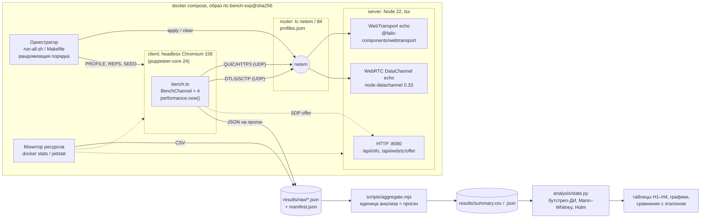

# Практическая работа № 3. Критерии научности исследования и проектирование экспериментального стенда

**Тема ВКР:** «Сравнительный анализ технологий WebRTC и WebTransport для передачи
данных в реальном времени в веб-приложениях».
**Артефакт:** репозиторий `rtc-benchmark`
(<https://github.com/HeavenlyGandalf/rtc-benchmark>), ветка
`docs/pr3-experiment-design`.
**Дата:** 03.11.2026.

---

## 1. Тема ВКР и постановка задачи

Для передачи данных в реальном времени из браузера сегодня есть два
стандартизованных транспорта. **WebRTC DataChannel** работает поверх
ICE + DTLS + SCTP и рассчитан прежде всего на P2P. **WebTransport** работает
поверх HTTP/3 и QUIC, устроен по схеме «клиент — сервер» и даёт как надёжные
потоки, так и ненадёжные дейтаграммы. В НИР-2 (29.06.2026) они теоретически
сравнены по 12 критериям и 6 сценариям применения. Вывод НИР-2 о том, что
нужны экспериментальные измерения, и задаёт задачу ВКР.

**Задача экспериментальной части:** на воспроизводимом стенде измерить время
установления соединения, задержку прикладного уровня (RTT) и её хвосты, потери
и пропускную способность для четырёх каналов (WT-поток, WT-дейтаграммы,
RTC надёжный, RTC ненадёжный) в контролируемых сетевых условиях. Затем
подтвердить или опровергнуть количественные утверждения НИР-2 (гипотезы
H1–H4 в разделе 4).

Стенд уже частично реализован: эхо-серверы WT и RTC на Node.js, общий
клиентский интерфейс `BenchChannel`, headless-раннер на puppeteer, Docker-образ
с `tc netem` и шесть сетевых профилей. В пилотном прогоне 01.11.2026 сделано
1–2 прогона на профиль. В этой работе я проектирую стенд и план эксперимента
так, чтобы по их результатам можно было делать статистически обоснованные выводы.

---

## 2. Подборка статей и сводная таблица анализа

### 2.1. Состав подборки

| № | Статья (кратко) | Эксперимент | ≤ 5 лет | Рецензируемое издание | Артефакт |
|---|---|---|---|---|---|
| [1] | Pham et al., HTTP/3 и WebTransport против WebRTC в live-стриминге | да | да (2025) | Springer CCIS | GitHub |
| [2] | Zhang et al., QUIC is not Quick Enough over Fast Internet | да | да (2024) | ACM WWW | Zenodo + GitHub |
| [3] | Engelbart, Ott, Congestion control for real-time media over QUIC | да | да (12.2021) | ACM EPIQ | GitHub |
| [4] | MacMillan et al., производительность видеоконференций (Zoom/Meet/Teams) | да | на границе (11.2021) | ACM IMC | не найден |
| [5] | Kakhki et al., Taking a Long Look at QUIC | да | нет (2017) | ACM IMC | код и данные |
| [6] | Jansen et al., Performance Evaluation of WebRTC-based Video Conferencing | да | нет (2017/2018) | ACM SIGMETRICS PER | GitHub |
| [7] | Sh3b0, realtime-web (WebSocket/WebRTC/WebTransport при потерях) | да (неформальный) | да | **нет**, серая литература | GitHub |

Требования выполнены: экспериментальных статей 7 (нужно ≥ 4), опубликованных за
последние 5 лет 3 строго ([1]–[3]) плюс [4] на границе, рецензируемых 6
([1]–[6]), с артефактами 6. Работа [7] не рецензирована. Она включена потому,
что это единственное найденное прямое сравнение WT и RTC при потерях с
открытым кодом. Использую её как ориентир для гипотез, а не как доказательство.

**Ограничение анализа.** Полные тексты [1] (Springer, платный доступ) и [3]
(ссылка на препринт не открылась) мне получить не удалось. Поля для них
заполнены по аннотации, метаданным и опубликованным репозиториям, это отмечено
в таблице. Полные тексты [2], [4], [5], [6] прочитаны.

### 2.2. Сводная таблица (глазами экспериментатора)

Таблица разбита на две части, чтобы она помещалась по ширине.

**Часть А: вопрос, объект, переменные, условия**

| № | Исследовательский вопрос / гипотеза | Объект (что измеряли) | Независимые переменные (уровни) | Зависимые переменные (единицы) | Контролируемые условия |
|---|---|---|---|---|---|
| [1] | Достигают ли HTTP/3 и WebTransport (MoQ) сквозной задержки уровня WebRTC в live-стриминге и удалённом рендеринге | Конвейер Unity → транспорт → браузер; moq-rs/moq-js против Unity Render Streaming (WebRTC) | Протокол (WebRTC / WT-MoQ / HTTP/3); сценарий (удалённый рендеринг / симуляция live-трансляции) | Сквозная задержка «glass-to-glass», мс | По репозиторию: одна машина, Chrome, Unity-сборка под Windows. Сеть не эмулируется (не указано) |
| [2] | Почему QUIC/HTTP3 медленнее TCP/HTTP2 на быстрых каналах; узкое место у получателя | Загрузка файлов, видео (dash.js), веб-страницы; клиенты cURL, quic_client, Chrome 102 и др. | Полоса 50–1000 Мбит/с (tc), трассы 4G/5G (Lumos5G); протокол H2/H3; клиент (5 браузеров); размер файла 50 МБ–1 ГБ | Пропускная способность, Мбит/с; время загрузки, с; CPU, %; PLT, TTFB, мс | Железо (Xeon E5-2640, i7-6700), Ubuntu 18.04, версии серверов (OpenLiteSpeed 1.7.15, nginx-quic), CUBIC для обоих, буферы > 10×BDP |
| [3] | Как сочетать управление перегрузкой для медиа (SCReAM) с управлением перегрузкой QUIC | RTP поверх QUIC-дейтаграмм (своя реализация на Go), видео через GStreamer | Конфигурация CC: UDP+SCReAM, QUIC+SCReAM, QUIC+SCReAM+NewReno, +поток, без RTCP | По репозиторию: скорость отправки относительно доступной полосы, Мбит/с; задержка (не установлено) | Mininet + tc, тестовый случай 1 из RFC 8867 (меняющаяся полоса), видео «Sintel» |
| [4] | Как VCA (Zoom, Meet, Teams) используют сеть и реагируют на ограничения полосы и конкуренцию | Клиенты VCA (нативные и в Chrome), двусторонний звонок | Полоса uplink/downlink {0,3; 0,4; … 1,5; 2; 5; 10} Мбит/с; платформа VCA; нативный клиент / браузер; число участников | Битрейт, Мбит/с; fps; ширина кадра, px; доля фризов, %; время восстановления, с | Два одинаковых Dell Latitude 3300, Ubuntu 20.04.1, проводной маршрутизатор Turris Omnia, Chrome 89.0.4389, версии клиентов, одно и то же видео 720p через ffmpeg |
| [5] | Действительно ли QUIC быстрее TCP и почему; корректное сравнение реализаций | QUIC (Chromium 52) и TCP+TLS: загрузка страниц и YouTube, десктоп и мобильные | Полоса, RTT, потери, переупорядочивание, размер и число объектов, тип устройства | PLT, мс (разница, %); качество видео; справедливость деления полосы | Свои QUIC-серверы на EC2, откалиброванные под Google; эмуляция на **отдельном маршрутизаторе**; подобранные параметры TBF; кэш и DNS исключены |
| [6] | Как WebRTC (GCC) ведёт себя при ограниченной полосе, задержке, потерях, конкуренции с TCP и в беспроводных сетях | Видеозвонок WebRTC 1080p50 между двумя узлами | Полоса 1500/750/250 Кбит/с; изменение задержки; потери; число конкурирующих потоков; сеть (синтетика / Wi-Fi / LTE) | Скорость данных, Кбит/с; RTT, мс; время разгона и сходимости, с | Dummynet; оба узла в одной проводной сети; Chrome 52+; кодеки по умолчанию (Opus, VP8); fake-device с фиксированным видео; проверка, что CPU не ограничивает качество (RTCStatsReport) |
| [7] | Как WebSocket, WebRTC и WebTransport доставляют поток сообщений при потерях | Поток из 2500 координат от сервера (Go) к клиенту | Протокол; потери 0 / 15 %; режим надёжный / ненадёжный | Доля доставленных сообщений; поведение во времени (точное определение не указано) | tc netem на `lo`; увеличенный UDP-буфер. Версии не указаны |

**Часть Б: стенд, методика, статистика, валидность, артефакты**

| № | Стенд | Методика (повторы, прогрев, длительность, порядок) | Статистическая обработка | Угрозы валидности (авторы / мои замечания) | Артефакты | Воспроизводимость (0–3) |
|---|---|---|---|---|---|---|
| [1] | Unity + moq-rs (Rust) + moq-js; Unity Render Streaming для WebRTC. Задержка измеряется по отметке времени в кадре и по видеозаписи экрана | Число повторов в репозитории не указано; прогрев не указан; ручной запуск по README | Ноутбуки Jupyter с графиками; ДИ и тестов значимости в репозитории нет | Авторы: не указано (текст недоступен). Мои: moq-rs «не последней версии», ручные шаги, сеть не эмулируется, клиент и сервер на одной машине — абсолютные задержки не переносятся на реальную сеть | <https://github.com/niklasCarlos/live-streaming-testbed>: код, CSV, ноутбуки; видео на Dropbox | **2** — код и данные есть, окружение не зафиксировано (Windows-сборка Unity, нет lock-файлов и контейнера) |
| [2] | Два хоста через 1 Гбит/с Ethernet (2 хопа), tc на канале; профилирование perf, tcpdump, HAR | 20 повторов на размер файла и на конфигурацию видео; 20 загрузок на каждую страницу; прогрев не описан | Среднее ± σ; ДИ и тестов нет | Авторы: в основном одна пара машин, мобильный случай только на Pixel 5. Мои: среднее ± σ при возможных тяжёлых хвостах; нет отдельного раздела об угрозах валидности | Zenodo 10.5281/zenodo.10679638, GitHub `Shawnxm/QUIC-not-Quick` | **2** — данные и скрипты есть, версии описаны, но нет контейнера, а среда (Chrome 102, Ubuntu 18.04) устарела |
| [3] | Mininet-топология, tc, RTP-over-QUIC (Go, quic-go), SCReAM, GStreamer; `main.py` прогоняет, `plot.py` строит графики | По README: один тестовый случай RFC 8867, одна последовательность видео; число повторов не указано | Временные ряды на графиках; статистики не указаны | Мои: только один тестовый случай RFC 8867; эмуляция в Mininet на одной машине; один видеоклип | <https://github.com/mengelbart/rtp-over-quic-mininet> (сабмодуль с реализацией) | **2** — скрипт запуска одной командой есть, но зависимости ставятся вручную, версии не зафиксированы |
| [4] | Два ноутбука, маршрутизатор, tc на линке C1; автоматизация звонков через PyAutoGUI и Selenium; логи WebRTC stats с секундным разрешением | 5 звонков по 2,5 мин на каждое условие; авторы обосновывают число повторов низкой дисперсией; порядок не указан | Медиана; полосы 90 % ДИ на графиках | Авторы: закрытые клиенты, серверы VCA вне контроля, путь через интернет. Мои: «5 повторов достаточно» утверждается без расчёта мощности; 90 % ДИ шире принятых 95 % | Не найден | **1** — методика описана подробно, артефактов нет; зависимость от проприетарных сервисов делает точный повтор невозможным |
| [5] | Клиенты (десктоп, смартфоны) ↔ маршрутизатор с tc/netem/TBF ↔ свои QUIC- и TCP-серверы; автоматизация через Python, Chrome devtools, adb | ≥ 10 раундов; **в каждом раунде TCP и QUIC чередуются back-to-back** против дрейфа; соединения не «прогреты» (кэш сбрасывается, 0-RTT-состояние сохраняется) | Разница в %; **тест Уэлча, p < 0,01**; незначимые разницы явно помечены (белые клетки) | Авторы: зависимость от версии QUIC, калибровка серверов, артефакты netem на конечном узле. Мои: одна версия Chromium; поправки на множественные сравнения нет при сотнях ячеек | Код и данные: <http://quic.ccs.neu.edu> | **2** — код и данные есть, контейнера нет, Chromium 52 сейчас не воспроизвести |
| [6] | Два узла в одной проводной сети, Dummynet как ограничитель; Chrome fake-device с одним и тем же видео 1080p50; статистика из RTCStatsReport раз в секунду | Длительность сессий 5–11 мин (по графикам); число повторов не указано; прогрев не описан | Временные ряды, средние за интервалы; ДИ и тестов нет | Авторы: беспроводные сети и кодеки VP9/H.264 работают не так, как ожидалось. Мои: похоже, по одному прогону на условие; точная версия Chrome «52 и выше» | <https://github.com/Wimnet/webrtc_performance> | **2** — код есть, окружение не зафиксировано |
| [7] | Серверы на Go (gorilla/websocket, pion/webrtc, webtransport-go), клиент на JS + Chart.js, netem на `lo` | Авторы пишут, что «результаты различались между прогонами», но число прогонов не указано | Нет, только видео и графики | Мои: один прогон на видео, netem на конечном узле, нет версий, метрика не определена операционально | <https://github.com/Sh3b0/realtime-web> | **1** — код и команды запуска есть, но версии, число прогонов и метрика не описаны, поэтому сопоставимые числа не получить |

### 2.3. Синтез: практика экспериментов в предметной области

**Что принято измерять.** В области «транспорт реального времени в браузере»
измеряют три группы величин:
1. **Задержку.** RTT, сквозную задержку «glass-to-glass» [1], время загрузки
   страницы и TTFB [2, 5]. Почти всегда берут медиану или среднее, хвосты
   (p95/p99) встречаются редко, хотя для интерактивных приложений важны именно
   они.
2. **Скорость.** Пропускная способность и битрейт [2, 4, 6], время разгона
   и восстановления после изменения полосы [3, 4, 6].
3. **Качество доставки.** Потери, fps, фризы [4, 6].

Время установления соединения считают реже, обычно как часть PLT. В [5]
отдельно учитывают вклад 0-RTT. Для моего исследования это важный пробел:
разница в рукопожатии (QUIC 1-RTT против ICE + DTLS + SCTP) — одно из главных
теоретических утверждений НИР-2.

**Как измеряют.** Стенд почти везде одинаковый: два узла, между ними
эмулятор сети (tc/netem/TBF [2, 4, 5], Dummynet [6], Mininet [3]), браузер
Chrome/Chromium под автоматизацией (devtools, Selenium, PyAutoGUI). Чтобы
нагрузка была одинаковой, источником видео служит заранее записанный ролик
через fake-device [4, 6]. Метрики берут из встроенной телеметрии
(RTCStatsReport [4, 6], HAR [2]) или из отметок времени в самом
приложении [1].

**Типичные ошибки.**
- *Мало повторов и нет статистики.* В [1], [3], [6], [7] число повторов не
  указано или, судя по всему, равно одному. Выводы делаются по виду
  временного ряда. Это как раз ошибка «один прогон и вывод „A быстрее B“».
- *Среднее ± σ без проверки формы распределения* [2]. У задержек тяжёлый
  правый хвост, поэтому среднее и σ плохо их описывают.
- *Эмуляция сети на конечном узле* [7]. В [5] прямо показано, что netem на
  конечной точке даёт «пачечный» трафик, а локальные потери сразу видны
  транспортному уровню. Пилотная версия моего стенда (netem на `lo`) повторяет
  эту ошибку, мера против неё описана в разделе 6.
- *Неоткалиброванный объект.* В [5] показано, что ранние работы сравнивали
  QUIC-серверы, не настроенные как у Google, и получали неверные выводы.
  Для меня аналог — сравнивать WebRTC, ожидающий полного сбора ICE-кандидатов
  (non-trickle), с WebTransport. Тогда измеряется особенность реализации,
  а не протокола (см. конструктную валидность, раздел 4.2).
- *Устаревшее, нефиксированное окружение* (Chrome 52 [5, 6], 89 [4], 102 [2]):
  повторить эти эксперименты в браузере той же версии уже нельзя.

**У кого методика лучше и почему.** Лучшая методика — в [5]. Там есть
калибровка объекта перед сравнением; эмуляция сети вынесена на отдельный
маршрутизатор; ≥ 10 раундов с чередованием сравниваемых вариантов
back-to-back, что убирает дрейф; явный тест значимости с отметкой незначимых
разниц; опубликованы код и данные. Работа [2] сильна инструментарием
(профилирование до причины) и артефактом на Zenodo, но слабее в статистике.
В [4] хорошая автоматизация и честные ДИ, но объект закрыт, поэтому повторить
эксперимент нельзя. Работа [1] ближе всех к моей теме (WT против WebRTC),
однако её методика (ручной запуск, нет эмуляции сети, не указано число
повторов) — пример того, чего мне нужно избежать.

**Что я беру в свой стенд:** у [5] — маршрутизатор-эмулятор, чередование и
рандомизацию, тест значимости, калибровку; у [4, 6] — fake-device с
фиксированным видео и сбор `getStats()`; у [2] — артефакт на Zenodo с DOI и
явный перечень версий; у [3] — запуск всего эксперимента одной командой.

---

## 3. Критерии научности исследования для ВКР

### 3.1. Исследовательский вопрос и гипотезы

**RQ.** Как различаются WebRTC DataChannel и WebTransport по времени
установления соединения и по задержке доставки сообщений прикладного уровня
(медиана и p95) при одинаковых контролируемых сетевых условиях (задержка,
джиттер, потери) в клиент-серверной браузерной архитектуре? Сохраняется ли
преимущество P2P-WebRTC по задержке относительно WebTransport через
сервер-ретранслятор?

Гипотезы взяты из утверждений НИР-2. Все они проверяются **на уровне
прогона** (единица анализа — раздел 5.4), уровень значимости α = 0,05 с
поправкой Холма по сетевым профилям.

| № | H₀ | H₁ (направление) | Метрика и сравнение |
|---|---|---|---|
| H1 | Медиана RTT P2P-WebRTC (A↔B) не отличается от медианы RTT пути A→сервер WT→B→A | RTT P2P **меньше**, чем через ретранслятор (односторонняя) | Медиана RTT за прогон; отношение relay/P2P |
| H2 | Медиана времени установления соединения WT равна медиане WebRTC | WT устанавливает соединение **быстрее** (односторонняя) | Медиана `setupMs` за прогон; отношение WT/RTC |
| H3 | При потерях (профили `4g`, `lossy`) p95 RTT надёжного упорядоченного канала RTC равен p95 ненадёжных каналов (WT-дейтаграмма, RTC unreliable) | У надёжного канала p95 **больше** (односторонняя) | p95 RTT за прогон; отношение reliable/unreliable |
| H4 | При потерях p95 RTT WT-потока равен p95 RTC reliable | Направление заранее не задаю (двусторонняя): в моём сценарии один поток, и HoL-блокировка внутри потока QUIC тоже возможна | p95 RTT за прогон |

H5 (масштабируемость, К8) проверяется в отдельной серии E3 и в этой работе
не детализируется.

### 3.2. Критерии научности применительно к теме

| Критерий | Как выполняется в моей ВКР |
|---|---|
| **Объективность и измеримость** | Все метрики определены операционально (таблица 3.3): RTT — `performance.now()` в браузере от момента перед `buildMessage+send` до прихода эха с тем же `seq`; время установления WT — от `new WebTransport()` до `ready`; RTC — от создания `RTCPeerConnection` до открытия DataChannel, включая сбор ICE и HTTP-сигналинг. Значения считаются кодом (`computeRttStats`), а не берутся из UI. Источник времени один (один хост), поэтому синхронизация часов не нужна |
| **Контроль переменных** | Фиксируются: образ контейнера (по digest), версии Chromium, Node и библиотек (yarn.lock), лимиты CPU и RAM контейнеров, размер сообщения, интервал отправки, параметры netem. Варьируются: канал, сетевой профиль, размер сообщения. Возможные искажения: фоновая нагрузка хоста, тепловой троттлинг, порядок каналов в прогоне, накопление состояния в сервере. Меры — в разделе 6 |
| **Повторяемость** | Автор на том же стенде получаю согласующийся результат. Проверка — A/A-тест (раздел 5.5): две независимые партии одной конфигурации не различаются значимо, отношение медиан в пределах 1 ± 0,05 |
| **Воспроизводимость** | Другой человек на моём артефакте (тег, образ по digest, `make verify`) получает результат в пределах допусков из раздела 4.3. Абсолютные значения на другом железе могут сдвинуться, поэтому критерием служат знак и порядок отношений (WT/RTC, relay/P2P) и попадание медиан в коридор ± 10 % от эталона |
| **Реплицируемость** | Другой человек **своей** реализацией (например, на Go: pion/webrtc + quic-go webtransport-go, как в [7], или на Rust: moq-rs, как в [1]) по описанию методики получает согласующиеся выводы: направление эффектов H1–H3 и пересечение ДИ отношений. Для этого в отчёте описываются формат сообщений (12-байтовый заголовок), эхо-семантика, параметры профилей и правило агрегации |
| **Внутренняя валидность** | Эффект вызван каналом, а не посторонними причинами: один клиентский код для всех каналов (`BenchChannel`), рандомизированный порядок, свежий контекст браузера на прогон, контроль CPU клиента и сервера, A/A-тест |
| **Внешняя валидность** | Профили соответствуют типичным сетям (Wi-Fi, 4G, 5G, сеть с потерями). Ограничения названы явно: только Chromium, синтетическая эмуляция вместо реальной сети, один сервер Node. Перенос на реальные сети проверяется контрольной серией из двух физических машин в ЛВС (если позволит время) |
| **Конструктная валидность** | «Задержка» здесь — это RTT прикладного уровня (включая обработку в JS и эхо-сервере), а не сетевой RTT; так это и называется в отчёте. Время установления RTC зависит от режима ICE: стенд ждёт полного сбора кандидатов (`waitIceComplete`). Поэтому дополнительно измеряется разбивка по фазам (сбор ICE / сигналинг / DTLS + SCTP), а режим ICE вводится как фактор. Тогда H2 сравнивает протоколы, а не мою реализацию |
| **Статистическая валидность** | Единица анализа — прогон, а не сообщение (раздел 5.4). Используются непараметрические тесты (Манн–Уитни), бутстреп-ДИ для отношений медиан, размер эффекта (δ Клиффа), поправка Холма. Число повторов выбирается по результатам пилота |
| **Фальсифицируемость** | Опровергающие исходы заданы заранее (раздел 3.4) |

### 3.3. Переменные

**Независимые (факторы).**

| Фактор | Уровни | Где задаётся |
|---|---|---|
| Канал | `wt-stream`, `wt-datagram`, `rtc-reliable` (ordered), `rtc-unreliable` (unordered, `maxRetransmits: 0`) | `MODES` в `bench.ts` |
| Сетевой профиль | `lan` (0 мс), `wifi` (15 ± 5 мс, 0,5 %), `4g` (50 ± 15 мс, 1 %), `5g` (25 ± 8 мс, 0,2 %), `lossy` (40 мс, 5 %), `limited` (20 мс, 5 Мбит/с) | `experiment/profiles.json` |
| Размер сообщения | 256 Б, 1024 Б (оба меньше лимита дейтаграммы 1200 Б, поэтому автоматическое уменьшение размера не срабатывает) | `RTT_SIZE` |
| Режим ICE (только H2) | полный сбор (текущий), trickle ICE | новый параметр `ICE_MODE` |
| Путь (только H1) | P2P A↔B; relay A→сервер→B→сервер→A | `compose-multihost.yml` |

**Зависимые.**

| Метрика | Единицы | Способ измерения |
|---|---|---|
| Время установления соединения | мс | `performance.now()` до/после, 30 рукопожатий в прогоне, пауза 100 мс; медиана за прогон |
| RTT: медиана, p95, p99 | мс | 1000 сообщений с интервалом 10 мс после 50 сообщений прогрева; перцентиль ближайшего ранга |
| Джиттер | мс | RFC 3550, `j += (|Δ| − j)/16` |
| Потери | % | `(отправлено − получено)/отправлено`, ожидание хвоста 500 мс |
| Пропускная способность | Мбит/с | сценарий 3, обратное давление по `writer.ready` / `bufferedAmount` |
| CPU клиента и сервера (контрольная) | % от лимита | `docker stats` каждую секунду |

**Контролируемые:** образ `rtc-bench-exp@sha256:…`; Chromium 156.0.8078.73;
Node 22.23.4; iproute2 6.15.0; ядро VM 6.10.14-linuxkit; лимиты контейнеров
(раздел 5.3); интервал отправки 10 мс; сертификат ECDSA P-256; пустой
`iceServers`; никакой другой нагрузки на хосте (закрыты IDE и браузер,
питание от сети, отключены Time Machine и Spotlight).

### 3.4. Критерий успеха и практическая значимость

Статистической значимости мало: эффект должен быть ещё и практически заметным.

| Гипотеза | Порог практической значимости | Обоснование |
|---|---|---|
| H1 | relay/P2P ≥ 1,2 и абсолютная разница ≥ 16,7 мс | 16,7 мс — один кадр при 60 Гц: меньшая разница не видна в интерактивном приложении (игры, совместное редактирование). Близкий порядок (несколько десятков мс) рассматривается в [1] как «сопоставимая» задержка |
| H2 | WT/RTC ≤ 0,75 и разница ≥ 1 RTT профиля | Теоретически QUIC экономит не меньше одного RTT по сравнению с ICE + DTLS + SCTP. В [5] выигрыш 0-RTT/1-RTT был заметен именно на малых объектах, где рукопожатие составляет большую часть времени |
| H3, H4 | отношение p95 ≥ 1,2 и разница ≥ 16,7 мс | Различия p95 меньше 20 % не выходят за межпрогонную изменчивость, которую показывает пилот; в [2] значимыми считались различия в десятки процентов |

**Что опровергнет гипотезы.**
- H1: 95 % ДИ отношения relay/P2P включает 1 хотя бы в одном профиле с
  задержкой > 0 (`wifi`, `4g`, `lossy`). Или relay оказывается быстрее P2P.
- H2: верхняя граница ДИ отношения WT/RTC ≥ 1 в режиме **trickle ICE**.
  Если преимущество WT есть только при полном сборе ICE, H2 считается
  опровергнутой как утверждение о протоколе.
- H3: под `lossy` ДИ отношения p95 reliable/unreliable включает 1 или
  отношение < 1.
- H4 двусторонняя: опровергается (H₀ не отвергается), если ДИ включает 1.

---

## 4. Как результаты проверят другие разработчики

### 4.1. Что и как фиксируется

| Что зафиксировать | Как в rtc-benchmark | Инструменты | Статус |
|---|---|---|---|
| Код | Тег релиза, по которому получены результаты отчёта: `v1.0-vkr` (и `v0.3-pr3` для этой работы); хеш коммита пишется в манифест | Git, GitHub Releases | тег — нужно создать |
| Зависимости | `yarn.lock` (Yarn 4 PnP), `packageManager: yarn@4.18.0` через Corepack; нативный модуль `@fails-components/webtransport-transport-http3-quiche` закреплён на точной версии 1.6.8; для анализа на Python — `uv.lock` | Yarn lockfile, Corepack, uv | есть (Node); `uv.lock` — нужно добавить |
| Окружение | Базовый образ закрепить по digest: `FROM node:22-trixie@sha256:<digest>`. Debian-пакеты (Chromium) — через `snapshot.debian.org` на фиксированную дату. Собранный образ публикуется в GHCR, в отчёте указывается его digest (сейчас локально `sha256:3463c6f2…`) | Dockerfile, Docker Compose, GHCR | частично: тег `node:22-trixie` плавающий |
| Данные | Входные данные — синтетические сообщения, их форма задана кодом. Видео для сценария 4 — Y4M-файл для `--use-file-for-fake-video-capture` с SHA-256 в `data/SHA256SUMS`. Сырые результаты и эталон публикуются на Zenodo с DOI | SHA-256, Zenodo | нужно добавить |
| Конфигурация эксперимента | Сетевые профили в `experiment/profiles.json`; параметры серии (REPS, RTT_COUNT, размеры, порядок) переносятся из env в `experiment/plan.yaml` | JSON/YAML | профили — есть, план — нужно сделать |
| Случайность | Порядок прогонов и каналов перемешивается генератором с сидом (`SEED` в плане, Mulberry32 в Node). Сид бутстрепа фиксирован (`numpy.random.default_rng(20261103)`). Сид netem не фиксируется (ядро его не поддерживает) — поэтому нужно много повторов | seed в манифесте | нужно добавить |
| Запуск | `make experiment` (полный план), `make verify` (сокращённый план и сравнение с эталоном), `make analyze` | Makefile | сейчас `docker compose … run --rm bench` |
| Метаданные прогона | `results/raw/<run-id>.manifest.json`: коммит, digest образа, версии Chromium, Node и ядра, CPU и RAM хоста, лимиты контейнеров, профиль, параметры, сид, номер в плане, время начала и конца, CPU клиента и сервера | JSON-манифест | частично: профиль и время уже пишутся |
| Независимая проверка | GitHub Actions: на каждый PR `yarn typecheck`, `yarn test` (эхо-тесты WT/RTC) и дымовой `make verify-smoke` (профили `lan` и `4g`, 3 прогона) на `ubuntu-latest` с `--cap-add NET_ADMIN`; по тегу — сборка и публикация образа | GitHub Actions | нужно добавить workflow |

### 4.2. Сценарий проверки

Проверяющему нужны Docker ≥ 24, 4 свободных ядра и 8 ГБ RAM, около 40 минут.

```bash
git clone https://github.com/HeavenlyGandalf/rtc-benchmark.git
cd rtc-benchmark
git checkout v1.0-vkr
```

```bash
docker pull ghcr.io/heavenlygandalf/rtc-bench-exp@sha256:<digest-из-отчёта>
```

```bash
make verify        # = PLAN=experiment/plan-verify.yaml: профили lan, 4g, lossy; 10 прогонов на конфигурацию
```

`make verify` выполняет по шагам:
1. Калибрует netem: UDP-эхо через маршрутизатор, медиана RTT должна быть
   2·delay ± 2 мс, потери — заданные ± 0,5 п.п. на 10⁴ пакетов. Если нет —
   останов с ошибкой (раздел 5.5).
2. Делает рандомизированные прогоны по плану, пишет сырые данные и манифесты
   в `results/verify/raw/`.
3. Агрегирует (`scripts/aggregate.mjs`) и анализирует (`analysis/stats.py`).
4. Сравнивает с эталоном `results/reference/summary.csv`
   (`scripts/compare.mjs`) и печатает таблицу PASS/FAIL.

**Что должно получиться и допуски:**

| Проверка | Ожидание (по пилоту 01.11.2026) | Допуск |
|---|---|---|
| Медиана RTT, `4g`, все 4 канала | ≈ 100–115 мс (2 × 50 мс netem + обработка) | ± 10 % от эталона |
| Медиана RTT, `lan` | 1,5–2,5 мс | абсолютные значения на `lan` **не сравниваются** (зависят от CPU), только отсутствие выбросов > 10 мс |
| Отношение времени установления WT/RTC, `lan` и `4g` | < 0,5 (пилот: 7,6/145 мс и 236/673 мс) | знак и порядок; ДИ эталона и проверки пересекаются |
| p95 RTT `rtc-reliable` / `wt-datagram`, `lossy` | > 1,2 | ДИ пересекаются; вывод по H3 тот же |
| A/A: две партии `wt-datagram`, `4g` | отношение медиан 1,00 | [0,95; 1,05], p > 0,05 |
| CPU клиента и сервера | < 70 % лимита | иначе прогон помечается невалидным |

Расхождения по абсолютным значениям при совпадении выводов (знаки эффектов,
пересечение ДИ) считаются успешной **воспроизводимостью**. Расхождение в
выводах — повод для разбора в разделе об ограничениях.

---

## 5. Проект экспериментального стенда

### 5.1. Архитектура

Диаграмма хранится в репозитории как код: `experiment/architecture.mmd`.
Это целевая схема, отличие от пилотного стенда — отдельный
контейнер-маршрутизатор.



Для H1 используется вариант из трёх контейнеров (`compose-multihost.yml`:
`server`, `peerA`, `peerB`). В целевой версии netem тоже переносится с `eth0`
пиров на контейнер-маршрутизатор.

### 5.2. Спецификация компонентов

| Компонент | Роль | Технология и версия | Образ | Обоснование |
|---|---|---|---|---|
| Объект (SUT): WT-эхо | Надёжные потоки (`pipeTo`) и дейтаграммы | `@fails-components/webtransport` 1.6.8 + quiche (нативный HTTP/3) | `rtc-bench-exp` (`node:22-trixie`, Debian 13 — нужен glibc 2.38) | Эхо без обработки, чтобы измерялся транспорт, а не логика приложения. В отличие от [1], где в измерение входит конвейер Unity и кодек |
| Объект (SUT): RTC-эхо | DataChannel надёжный и ненадёжный, эхо RTP | `node-datachannel` 0.33 (libdatachannel) | тот же | Серверная реализация WebRTC без браузера на стороне сервера; симметрично WT-эху |
| Источник воздействия | Сообщения `[seq][sendTime][padding]` с интервалом 10 мс; рукопожатия; поток для пропускной способности | `bench.ts` в headless Chromium 156 через `puppeteer-core` 24 | тот же | Один клиентский код для всех каналов (`BenchChannel`). Как в [4, 6], нагрузка детерминирована (fake-device, фиксированные сообщения) |
| Эмулятор сети | Задержка, джиттер, потери, полоса | `tc netem` + `tbf`, iproute2 6.15.0 | `router` (тот же образ, `NET_ADMIN`) | Как в [5]: эмуляция на отдельном узле, а не на конечной точке (в пилоте netem стоит на `lo` — угроза из [5, 7]). Профили по аналогии с [2] (сотовые) и [6] (ограничение полосы) |
| Оркестратор | Порядок прогонов, применение профилей, перезапуск браузера | bash `run-all.sh` → Makefile + `plan.yaml` | — | Чередование и рандомизация как в [5]; запуск одной командой как в [3] |
| Сбор измерений | Сырые выборки RTT и setup на прогон; `getStats()` для видео | `window.__bench` → `page.evaluate` → JSON | — | Сырые числа, а не текст из DOM; телеметрия браузера как в [4, 6] |
| Монитор ресурсов | CPU и RAM клиента и сервера, лаг event loop Node | `docker stats`, `perf_hooks.monitorEventLoopDelay` | — | Проверка, что генератор не узкое место; аналог проверки CPU через RTCStatsReport в [6] |
| Хранилище | `results/raw/*.json` + манифесты; эталон; публикация | файловая система, Zenodo | — | Как в [2]: данные с DOI |
| Анализ | Агрегация по прогонам, ДИ, тесты, графики | `aggregate.mjs` (Node) + `analysis/stats.py` (Python 3.12, numpy, scipy, pandas, matplotlib; `uv.lock`) | `python:3.12-slim@sha256` | Непараметрика и бутстреп вместо среднего ± σ из [2]; тест значимости как в [5] |

### 5.3. Спецификация окружения

| Параметр | Значение |
|---|---|
| Хост | Apple M4 Pro (12 ядер), 24 ГБ RAM, macOS 26.4.1 |
| Виртуализация | Docker Desktop 28.4.0, Linux VM: 12 vCPU, 8 ГБ, ядро 6.10.14-linuxkit |
| Контейнеры | `client`: `cpus: 4`, `mem_limit: 3g`; `server`: `cpus: 2`, `mem_limit: 1g`; `router`: `cpus: 1`, `mem_limit: 256m`. `shm_size: 1g` для Chromium |
| ПО в образе | Debian 13.7, Node 22.23.4, Chromium 156.0.8078.73, iproute2 6.15.0, Yarn 4.18.0 |
| Сеть | Docker bridge между контейнерами; netem на исходящих интерфейсах маршрутизатора в обе стороны, поэтому RTT ≈ 2·delay. MTU 1500. `iceServers: []` (TURN не используется) |
| Режим хоста | Питание от сети, режим «Высокая производительность», никаких других приложений; перед серией пауза 5 мин для стабилизации температуры |
| Фиксация | Всё перечисленное (кроме режима хоста) пишется в `manifest.json` каждого прогона |

### 5.4. План эксперимента

**Серии и факторы.**

| Серия | Факторы и уровни | План | Конфигураций |
|---|---|---|---|
| E1 — RTT / потери (H3, H4) | канал (4) × профиль (6) × размер (2) | полный факторный | 48 |
| E2 — установление соединения (H2) | транспорт (2) × профиль (6) × режим ICE (2, только для RTC) | полный, WT без фактора ICE | 6 + 12 = 18 |
| E3 — P2P против relay (H1) | путь (2) × профиль (`lan`, `wifi`, `4g`, `lossy`) | полный | 8 |
| E0 — проверка стенда | A/A, калибровка (раздел 5.5) | — | 3 |

Дробный план не нужен: прогон длится десятки секунд, и полный план E1
(48 × 10 = 480 прогонов по ~25 с) укладывается примерно в 3,5 часа.

**Число повторов.** 10 независимых прогонов на конфигурацию (в пилоте было
1–2). Обоснование: это ориентир задания и практика [5] (≥ 10); [4] использует 5,
[2] — 20. После первых 10 прогонов по пилотной части считается половина ширины
95 % бутстреп-ДИ медианы. Если она больше 5 % медианы (или больше 2 мс на
`lan`), число повторов увеличивается до 20. Внутри прогона: 1000 сообщений RTT
(чтобы p99 опирался примерно на 10 наблюдений хвоста, а не на 2, как при
200 сообщениях в пилоте) и 30 рукопожатий для E2.

**Прогрев.** В каждом прогоне сначала 50 сообщений прогрева (в статистику не
входят; в пилоте было 10), для E2 — одно отбрасываемое рукопожатие (кэш
сертификата, JIT). Перед серией выполняется один полный прогон, который
отбрасывается целиком (первый запуск Chromium и сервера). После применения
профиля netem пауза 2 с.

**Длительность.** Сценарий 2: 1000 × 10 мс = 10 с + прогрев 0,5 с + хвост
0,5 с на канал. Сценарий 3: 10 с на канал (в пилоте 3 с — меньше времени
разгона CC, особенно на `limited`).

**Порядок.** Полный список (конфигурация × повтор) перемешивается с
фиксированным сидом. Каждый прогон — свежий контекст браузера (новая страница
и новые соединения). Порядок каналов внутри прогона тоже случайный (в пилоте
он фиксирован: WT-поток всегда первый, это даёт систематический эффект
порядка). Сравниваемые варианты одного профиля идут близко по времени, как в
[5], поэтому дрейф (нагрев, фоновые процессы) равномерно распределяется по
вариантам.

**Единица анализа.** Один прогон: из него получаются медиана, p95 и p99 RTT,
потери и медиана времени установления. Отдельные сообщения независимыми
наблюдениями не считаются. Соседние сообщения в одном соединении зависят друг
от друга через состояние окна перегрузки, очереди netem, повторные передачи
и HoL-блокировку. Если считать 1000 сообщений как n = 1000, получится
псевдорепликация и сильно заниженные p-value.

**Метод анализа.**
1. Для каждой конфигурации — медиана по прогонам и 95 % бутстреп-ДИ
   (10 000 перевыборок, BCa, фиксированный сид). Дополнительно IQR и
   boxplot по прогонам.
2. Сравнение двух вариантов — отношение медиан с бутстреп-ДИ и критерий
   Манна–Уитни (односторонний для H1–H3, двусторонний для H4). Размер
   эффекта — δ Клиффа. Для проверки устойчивости — тест Уэлча на
   логарифмах, как в [5].
3. Множественные сравнения по профилям — поправка Холма–Бонферрони внутри
   каждой гипотезы.
4. Решение: H₀ отвергается, если p_Holm < 0,05, **и** эффект превышает
   порог практической значимости (раздел 3.4).
5. Распределения внутри прогона (ECDF RTT) показываются на графиках
   для иллюстрации, но в тестах не используются.

### 5.5. Проверка самого стенда

| Проверка | Как | Критерий прохождения |
|---|---|---|
| **A/A-тест** | Конфигурации `wt-datagram × 4g` и `rtc-reliable × 4g`, по две независимые партии из 10 прогонов, разнесённые по времени в рандомизированном расписании | Манн–Уитни p > 0,05; 95 % ДИ отношения медиан содержит 1 и лежит в [0,95; 1,05]. Если не проходит — ищется источник дрейфа, основная серия не начинается |
| **Генератор не узкое место** | CPU контейнера `client` и процесса Chromium (`docker stats`, 1 Гц); лаг event loop Node на сервере (`monitorEventLoopDelay`); дополнительно — прогон с интервалом 20 мс вместо 10 мс | CPU клиента < 70 % лимита, p99 лага event loop < 5 мс; медиана RTT при 10 и 20 мс отличается < 5 % (иначе мы измеряем очередь отправки, а не транспорт) |
| **Калибровка netem** | UDP-эхо (без QUIC и SCTP) через маршрутизатор под каждым профилем, 10⁴ пакетов | Медиана RTT = 2·delay ± 2 мс; потери = 1 − (1 − p)² ± 0,5 п.п. (потери в обе стороны). Пилот согласуется с этим: `4g` (50 мс) даёт медианы 102–114 мс |
| **Калибровка на известном результате** | (1) На `lan` RTT каналов должен быть порядка единиц мс, как на loopback. (2) Число RTT рукопожатия: под профилем с delay = d время установления WT ≈ k·2d + c, где k — число обменов QUIC + HTTP/3 + CONNECT (ожидается 2–3) | Наклон прямой setup(d) по профилям `lan`, `5g`, `lossy`, `4g` согласуется с теоретическим числом обменов. Это проверяет, что измеряется именно рукопожатие |
| **Целостность данных** | Число полученных эхо-сообщений с дубликатами `seq`; монотонность `performance.now()` | Дубликатов нет; отрицательных RTT нет |

### 5.6. Угрозы валидности и меры против них

| Тип | Угроза | Мера |
|---|---|---|
| Внутренняя | Эмуляция netem на конечном узле (`lo` / `eth0` пира) искажает поведение транспорта: пачечность и мгновенная локальная обратная связь о потерях [5] | Отдельный контейнер-маршрутизатор; контрольное сравнение «netem на `lo`» и «маршрутизатор» на `lossy` — разница фиксируется как результат |
| Внутренняя | Фиксированный порядок каналов в прогоне (WT-поток первым) | Случайный порядок каналов в каждом прогоне с сидом |
| Внутренняя | Дрейф: нагрев M4 Pro, фоновые процессы macOS, VM Docker Desktop | Рандомизация, пауза перед серией, A/A-тест в начале и в конце, CPU в манифесте |
| Внутренняя | Сервер — один поток Node: обработка RTC-эха и WT-эха может различаться по стоимости | Мониторинг лага event loop; видеосценарий отдельно от сценариев 1–3; при необходимости — отдельные процессы для WT и RTC |
| Внутренняя | Накопление состояния сервера между прогонами (сессии, память) | Перезапуск контейнера `server` каждые N прогонов, проверка утечек по RAM |
| Конструктная | Время установления RTC включает ожидание полного сбора ICE — особенность реализации, а не протокола | Фактор «режим ICE» (full / trickle); разбивка по фазам |
| Конструктная | «RTT» включает JS-обработку и эхо, а не только сеть | Называть метрику «RTT прикладного уровня»; калибровка UDP-эхом даёт базу для вычитания |
| Конструктная | Размер сообщения автоматически уменьшается под лимит канала, а в результатах указан запрошенный | Размеры 256 и 1024 Б (меньше 1200 Б); фактический размер пишется в сырые данные |
| Конструктная | Потери в сценарии 3 включают хвост, не успевший вернуться за 700 мс дренажа | Окно дренажа пропорционально RTT профиля (≥ 4·RTT); потери надёжных каналов считать «невозвращёнными к сроку» |
| Статистическая | Псевдорепликация (сообщения как наблюдения) | Единица анализа — прогон |
| Статистическая | Мало прогонов (пилот: 1–2), неустойчивый p99 по 200 сообщениям | 10–20 прогонов, 1000 сообщений, бутстреп-ДИ |
| Статистическая | Множественные сравнения (4 канала × 6 профилей) | Поправка Холма, гипотезы заданы заранее (раздел 3.1) |
| Внешняя | Только Chromium; серверные реализации (quiche через Node-обвязку, libdatachannel) отличаются от продакшн-серверов | Ограничение явно в выводах; контрольная серия реплицируемости на другой реализации (Go: pion + webtransport-go) — по возможности |
| Внешняя | Синтетические профили вместо реальных сетей; одна машина | Профили взяты из типичных значений; контрольная серия на двух физических машинах в ЛВС и через мобильную точку доступа |
| Внешняя | Версия Chromium быстро устаревает (в [4–6] уже не воспроизвести) | Образ с Chromium публикуется в GHCR по digest, сырые данные — на Zenodo |

### 5.7. Черновик структуры репозитория

```text
rtc-benchmark/
├── src/
│   ├── client/            # bench.ts, util.ts (computeRttStats), transports/ (4 реализации BenchChannel), video/
│   └── server/            # index.ts (HTTP, сигналинг), webtransport.ts, webrtc.ts — эхо-серверы (SUT)
├── public/                # собранный клиентский бандл (esbuild)
├── scripts/               # раннеры (run-series, run-scale, run-peer-a/b), aggregate*.mjs, e2e, эхо-тесты
│   └── compare.mjs        # [новое] сравнение с эталоном и допуски для make verify
├── experiment/
│   ├── Dockerfile         # образ стенда; [доработка] FROM … @sha256, snapshot.debian.org
│   ├── compose.yml        # одноузловой прогон (пилот, netem на lo)
│   ├── compose-multihost.yml  # H1: server + peerA + peerB
│   ├── compose-router.yml # [новое] client ↔ router(netem) ↔ server
│   ├── profiles.json      # сетевые профили
│   ├── plan.yaml          # [новое] факторы, уровни, повторы, сид, длительности
│   ├── plan-verify.yaml   # [новое] сокращённый план для проверяющего
│   ├── netem.mjs          # применение/снятие профилей
│   ├── run-*.sh           # оркестрация внутри контейнера
│   └── architecture.mmd   # диаграмма стенда (этот отчёт, раздел 5.1)
├── analysis/              # [новое] stats.py, notebooks/, pyproject.toml + uv.lock
├── data/                  # [новое] видео для fake-device + SHA256SUMS
├── results/
│   ├── raw/               # сырые JSON + manifest.json на прогон (в git не коммитятся, публикуются на Zenodo)
│   ├── reference/         # [новое] эталонная сводка для make verify
│   └── summary.csv/json   # агрегаты
├── docs/                  # сайт MkDocs: методика, сценарии, ограничения, план эксперимента
├── reports/               # отчёты по практическим работам (этот файл)
├── .github/workflows/     # deploy*.yml; [новое] ci.yml (typecheck, test, verify-smoke)
├── Makefile               # [новое] experiment / verify / analyze / clean
├── package.json, yarn.lock, .yarnrc.yml   # зависимости Node, Yarn 4 через Corepack
└── README.md
```

---

## 6. Ответы на вопросы для самопроверки

**Какой результат опроверг бы гипотезу?** Для H2 — если при trickle ICE
95 % ДИ отношения WT/RTC времени установления включает 1. Для H1 — если ДИ
отношения relay/P2P включает 1 при ненулевой задержке профиля. Для H3 — если
под `lossy` p95 надёжного RTC-канала не больше, чем у дейтаграмм WT
(раздел 3.4).

**Чем отличаются воспроизводимость и реплицируемость в моём случае?**
Воспроизводимость — другой человек запускает **мой** образ и код по тегу
(`make verify`) и получает те же выводы при допустимом разбросе абсолютных
значений. Реплицируемость — другой человек пишет **свои** эхо-серверы и
клиент (например, на Go с pion и webtransport-go) по описанию формата
сообщений, профилей и правил агрегации и получает то же направление эффектов
H1–H3.

**Почему отдельные запросы нельзя считать независимыми наблюдениями?**
Сообщения одного прогона идут по одному соединению и делят его состояние:
окно перегрузки, очереди netem, повторные передачи. При HoL-блокировке одна
потеря задерживает сразу несколько следующих сообщений. Поэтому соседние RTT
коррелированы, и n = 1000 сообщений даёт ложную точность. Независимы только
прогоны с новыми соединениями и новым контекстом браузера.

**Что сломается, если запустить эксперимент на другом ноутбуке?**
1. Абсолютные RTT на `lan` и пропускная способность: они ограничены CPU.
2. На Intel/AMD-хосте образ соберётся под amd64 — нужно проверить, что есть
   предсобранный нативный модуль quiche (он требует glibc ≥ 2.38).
3. На Linux без Docker Desktop не будет VM-прослойки — изменятся накладные
   расходы на `lo`.
4. Сертификат живёт 13 дней: на старом артефакте он истечёт и будет
   перегенерирован (отпечаток другой — это нормально).
5. Если образ собирать заново, а не брать по digest, apt подтянет другую
   версию Chromium.

Поэтому критерий воспроизводимости опирается на отношения и знаки эффектов,
а версии фиксируются через digest образа.

---

## Список литературы

1. Pham S., Haarbeck N., Nguyen M., Busse D., Bassbouss L., Arbanowski S.,
   Steglich S. An Evaluation of HTTP/3 and WebTransport over QUIC in Live Low
   Latency Video Streaming // Information and Communication Technology
   (SOICT 2024). Communications in Computer and Information Science. —
   Singapore: Springer, 2025. — P. 284–296. — DOI:
   10.1007/978-981-96-4288-5_23. Артефакт:
   <https://github.com/niklasCarlos/live-streaming-testbed>.
2. Zhang X., Jin S., He Y., Hassan A., Mao Z. M., Qian F., Zhang Z.-L. QUIC is
   not Quick Enough over Fast Internet // Proceedings of the ACM Web Conference
   2024 (WWW '24). — ACM, 2024. — P. 2713–2722. — DOI:
   10.1145/3589334.3645323. Артефакт: DOI 10.5281/zenodo.10679638.
3. Engelbart M., Ott J. Congestion control for real-time media over QUIC //
   Proceedings of the 2021 Workshop on Evolution, Performance and
   Interoperability of QUIC (EPIQ '21). — ACM, 2021. — P. 1–7. — DOI:
   10.1145/3488660.3493801. Артефакт:
   <https://github.com/mengelbart/rtp-over-quic-mininet>.
4. MacMillan K., Mangla T., Saxon J., Feamster N. Measuring the Performance
   and Network Utilization of Popular Video Conferencing Applications //
   Proceedings of the 21st ACM Internet Measurement Conference (IMC '21). —
   ACM, 2021. — DOI: 10.1145/3487552.3487842. Препринт: arXiv:2105.13478.
5. Molavi Kakhki A., Jero S., Choffnes D., Nita-Rotaru C., Mislove A. Taking a
   Long Look at QUIC: An Approach for Rigorous Evaluation of Rapidly Evolving
   Transport Protocols // Proceedings of the 2017 Internet Measurement
   Conference (IMC '17). — ACM, 2017. — P. 290–303. — DOI:
   10.1145/3131365.3131368.
6. Jansen B., Goodwin T., Gupta V., Kuipers F., Zussman G. Performance
   Evaluation of WebRTC-based Video Conferencing // ACM SIGMETRICS Performance
   Evaluation Review. — 2018. — Vol. 45, № 3. — P. 56–68. — DOI:
   10.1145/3199524.3199534. Артефакт:
   <https://github.com/Wimnet/webrtc_performance>.
7. Sh3b0. realtime-web: WebSocket, WebRTC and WebTransport under packet loss
   [Электронный ресурс]. — GitHub. — URL: <https://github.com/Sh3b0/realtime-web>
   (дата обращения: 03.11.2026). — Нерецензируемый источник.
8. ACM. Artifact Review and Badging — Current [Электронный ресурс]. — URL:
   <https://www.acm.org/publications/policies/artifact-review-and-badging-current>
   (дата обращения: 03.11.2026).
9. Schulzrinne H., Casner S., Frederick R., Jacobson V. RFC 3550. RTP: A
   Transport Protocol for Real-Time Applications. — IETF, 2003. — DOI:
   10.17487/RFC3550.
10. Sarker Z., Singh V., Zhu X., Ramalho M. RFC 8867. Test Cases for Evaluating Congestion
    Control for Interactive Real-Time Media. — IETF, 2021. — DOI:
    10.17487/RFC8867.
