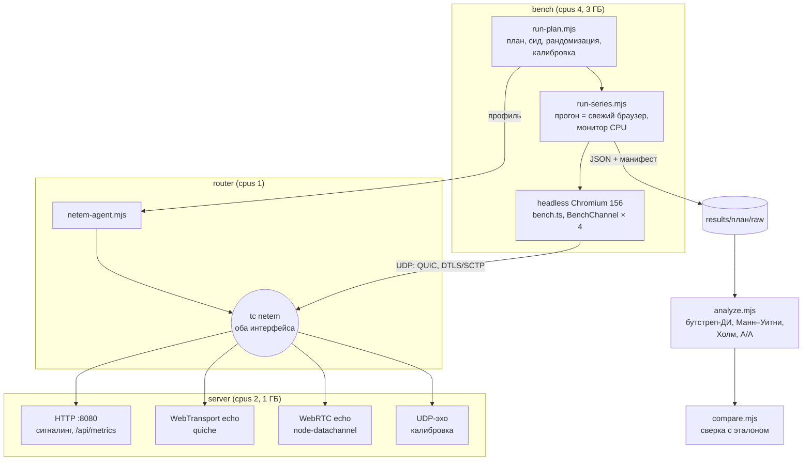

# Практическая работа № 3. Критерии научности исследования и проектирование экспериментального стенда

**Тема ВКР:** «Сравнительный анализ технологий WebRTC и WebTransport для передачи
данных в реальном времени в веб-приложениях».
**Артефакт:** репозиторий `rtc-benchmark`
(<https://github.com/HeavenlyGandalf/rtc-benchmark>), ветка
`docs/pr3-experiment-design`, тег `pr3`.
**Дата:** 04.11.2026.

---

## 1. Тема ВКР и постановка задачи

Для передачи данных в реальном времени из браузера сегодня есть два
стандартизованных транспорта. **WebRTC DataChannel** работает поверх
ICE + DTLS + SCTP и рассчитан прежде всего на P2P. **WebTransport** работает
поверх HTTP/3 и QUIC, устроен по схеме «клиент — сервер» и даёт как надёжные
потоки, так и ненадёжные дейтаграммы. В НИР-2 (29.06.2026) они теоретически
сравнены по 12 критериям и 6 сценариям применения. Вывод НИР-2 о том, что
нужны экспериментальные измерения, и задаёт задачу ВКР.

**Задача экспериментальной части:** на воспроизводимом стенде измерить время
установления соединения, задержку прикладного уровня (RTT) и её хвосты, потери
и пропускную способность для четырёх каналов (WT-поток, WT-дейтаграммы,
RTC надёжный, RTC ненадёжный) в контролируемых сетевых условиях. Затем
подтвердить или опровергнуть количественные утверждения НИР-2 (гипотезы
H1–H4 в разделе 3).

До этой работы у стенда были эхо-серверы WT и RTC на Node.js, общий
клиентский интерфейс `BenchChannel`, headless-раннер на puppeteer, Docker-образ
с `tc netem` на `lo` и шесть сетевых профилей. Пилотный прогон 01.11.2026 дал
1–2 прогона на профиль. В этой работе по требованиям, выведенным из практики
области (раздел 3), стенд спроектирован и **доведён до исполнимого
состояния**: эмуляция сети вынесена на отдельный контейнер-маршрутизатор,
добавлены план эксперимента с сидом, калибровка, A/A-тест, манифест прогона,
контроль ресурсов, анализ по прогонам и сверка с эталоном одной командой
(`make verify`). Проверочная серия на 40 прогонов выполнена дважды; её
результаты — в разделе 6.

---

## 2. Подборка статей и сводная таблица анализа

### 2.1. Состав подборки

| № | Статья (кратко) | Эксперимент | ≤ 5 лет | Рецензируемое издание | Артефакт |
|---|---|---|---|---|---|
| [1] | Pham et al., HTTP/3 и WebTransport против WebRTC в live-стриминге | да | да (2025) | Springer CCIS | GitHub |
| [2] | Zhang et al., QUIC is not Quick Enough over Fast Internet | да | да (2024) | ACM WWW | Zenodo + GitHub |
| [3] | Engelbart, Ott, Congestion control for real-time media over QUIC | да | да (12.2021) | ACM EPIQ | GitHub |
| [4] | MacMillan et al., производительность видеоконференций (Zoom/Meet/Teams) | да | на границе (11.2021) | ACM IMC | не найден |
| [5] | Kakhki et al., Taking a Long Look at QUIC | да | нет (2017) | ACM IMC | код и данные |
| [6] | Jansen et al., Performance Evaluation of WebRTC-based Video Conferencing | да | нет (2017/2018) | ACM SIGMETRICS PER | GitHub |
| [7] | Sh3b0, realtime-web (WebSocket/WebRTC/WebTransport при потерях) | да (неформальный) | да | **нет**, серая литература | GitHub |

Требования выполнены: экспериментальных статей 7 (нужно ≥ 4), опубликованных за
последние 5 лет 3 строго ([1]–[3]) плюс [4] на границе, рецензируемых 6
([1]–[6]), с артефактами 6. Работа [7] не рецензирована. Она включена потому,
что это единственное найденное прямое сравнение WT и RTC при потерях с
открытым кодом. Использую её как ориентир для гипотез, а не как доказательство.

**Ограничение анализа.** Полные тексты [1] (Springer, платный доступ) и [3]
(ссылка на препринт не открылась) мне получить не удалось. Поля для них
заполнены по аннотации, метаданным и опубликованным репозиториям, это отмечено
в таблице. Полные тексты [2], [4], [5], [6] прочитаны.

### 2.2. Сводная таблица (глазами экспериментатора)

Таблица разбита на две части, чтобы она помещалась по ширине.

**Часть А: вопрос, объект, переменные, условия**

| № | Исследовательский вопрос / гипотеза | Объект (что измеряли) | Независимые переменные (уровни) | Зависимые переменные (единицы) | Контролируемые условия |
|---|---|---|---|---|---|
| [1] | Достигают ли HTTP/3 и WebTransport (MoQ) сквозной задержки уровня WebRTC в live-стриминге и удалённом рендеринге | Конвейер Unity → транспорт → браузер; moq-rs/moq-js против Unity Render Streaming (WebRTC) | Протокол (WebRTC / WT-MoQ / HTTP/3); сценарий (удалённый рендеринг / симуляция live-трансляции) | Сквозная задержка «glass-to-glass», мс | По репозиторию: одна машина, Chrome, Unity-сборка под Windows. Сеть не эмулируется (не указано) |
| [2] | Почему QUIC/HTTP3 медленнее TCP/HTTP2 на быстрых каналах; узкое место у получателя | Загрузка файлов, видео (dash.js), веб-страницы; клиенты cURL, quic_client, Chrome 102 и др. | Полоса 50–1000 Мбит/с (tc), трассы 4G/5G (Lumos5G); протокол H2/H3; клиент (5 браузеров); размер файла 50 МБ–1 ГБ | Пропускная способность, Мбит/с; время загрузки, с; CPU, %; PLT, TTFB, мс | Железо (Xeon E5-2640, i7-6700), Ubuntu 18.04, версии серверов (OpenLiteSpeed 1.7.15, nginx-quic), CUBIC для обоих, буферы > 10×BDP |
| [3] | Как сочетать управление перегрузкой для медиа (SCReAM) с управлением перегрузкой QUIC | RTP поверх QUIC-дейтаграмм (своя реализация на Go), видео через GStreamer | Конфигурация CC: UDP+SCReAM, QUIC+SCReAM, QUIC+SCReAM+NewReno, +поток, без RTCP | По репозиторию: скорость отправки относительно доступной полосы, Мбит/с; задержка (не установлено) | Mininet + tc, тестовый случай 1 из RFC 8867 (меняющаяся полоса), видео «Sintel» |
| [4] | Как VCA (Zoom, Meet, Teams) используют сеть и реагируют на ограничения полосы и конкуренцию | Клиенты VCA (нативные и в Chrome), двусторонний звонок | Полоса uplink/downlink {0,3; 0,4; … 1,5; 2; 5; 10} Мбит/с; платформа VCA; нативный клиент / браузер; число участников | Битрейт, Мбит/с; fps; ширина кадра, px; доля фризов, %; время восстановления, с | Два одинаковых Dell Latitude 3300, Ubuntu 20.04.1, проводной маршрутизатор Turris Omnia, Chrome 89.0.4389, версии клиентов, одно и то же видео 720p через ffmpeg |
| [5] | Действительно ли QUIC быстрее TCP и почему; корректное сравнение реализаций | QUIC (Chromium 52) и TCP+TLS: загрузка страниц и YouTube, десктоп и мобильные | Полоса, RTT, потери, переупорядочивание, размер и число объектов, тип устройства | PLT, мс (разница, %); качество видео; справедливость деления полосы | Свои QUIC-серверы на EC2, откалиброванные под Google; эмуляция на **отдельном маршрутизаторе**; подобранные параметры TBF; кэш и DNS исключены |
| [6] | Как WebRTC (GCC) ведёт себя при ограниченной полосе, задержке, потерях, конкуренции с TCP и в беспроводных сетях | Видеозвонок WebRTC 1080p50 между двумя узлами | Полоса 1500/750/250 Кбит/с; изменение задержки; потери; число конкурирующих потоков; сеть (синтетика / Wi-Fi / LTE) | Скорость данных, Кбит/с; RTT, мс; время разгона и сходимости, с | Dummynet; оба узла в одной проводной сети; Chrome 52+; кодеки по умолчанию (Opus, VP8); fake-device с фиксированным видео; проверка, что CPU не ограничивает качество (RTCStatsReport) |
| [7] | Как WebSocket, WebRTC и WebTransport доставляют поток сообщений при потерях | Поток из 2500 координат от сервера (Go) к клиенту | Протокол; потери 0 / 15 %; режим надёжный / ненадёжный | Доля доставленных сообщений; поведение во времени (точное определение не указано) | tc netem на `lo`; увеличенный UDP-буфер. Версии не указаны |

**Часть Б: стенд, методика, статистика, валидность, артефакты**

| № | Стенд | Методика (повторы, прогрев, длительность, порядок) | Статистическая обработка | Угрозы валидности (авторы / мои замечания) | Артефакты | Воспроизводимость (0–3) |
|---|---|---|---|---|---|---|
| [1] | Unity + moq-rs (Rust) + moq-js; Unity Render Streaming для WebRTC. Задержка измеряется по отметке времени в кадре и по видеозаписи экрана | Число повторов в репозитории не указано; прогрев не указан; ручной запуск по README | Ноутбуки Jupyter с графиками; ДИ и тестов значимости в репозитории нет | Авторы: не указано (текст недоступен). Мои: moq-rs «не последней версии», ручные шаги, сеть не эмулируется, клиент и сервер на одной машине — абсолютные задержки не переносятся на реальную сеть | <https://github.com/niklasCarlos/live-streaming-testbed>: код, CSV, ноутбуки; видео на Dropbox | **2** — код и данные есть, окружение не зафиксировано (Windows-сборка Unity, нет lock-файлов и контейнера) |
| [2] | Два хоста через 1 Гбит/с Ethernet (2 хопа), tc на канале; профилирование perf, tcpdump, HAR | 20 повторов на размер файла и на конфигурацию видео; 20 загрузок на каждую страницу; прогрев не описан | Среднее ± σ; ДИ и тестов нет | Авторы: в основном одна пара машин, мобильный случай только на Pixel 5. Мои: среднее ± σ при возможных тяжёлых хвостах; нет отдельного раздела об угрозах валидности | Zenodo 10.5281/zenodo.10679638, GitHub `Shawnxm/QUIC-not-Quick` | **2** — данные и скрипты есть, версии описаны, но нет контейнера, а среда (Chrome 102, Ubuntu 18.04) устарела |
| [3] | Mininet-топология, tc, RTP-over-QUIC (Go, quic-go), SCReAM, GStreamer; `main.py` прогоняет, `plot.py` строит графики | По README: один тестовый случай RFC 8867, одна последовательность видео; число повторов не указано | Временные ряды на графиках; статистики не указаны | Мои: только один тестовый случай RFC 8867; эмуляция в Mininet на одной машине; один видеоклип | <https://github.com/mengelbart/rtp-over-quic-mininet> (сабмодуль с реализацией) | **2** — скрипт запуска одной командой есть, но зависимости ставятся вручную, версии не зафиксированы |
| [4] | Два ноутбука, маршрутизатор, tc на линке C1; автоматизация звонков через PyAutoGUI и Selenium; логи WebRTC stats с секундным разрешением | 5 звонков по 2,5 мин на каждое условие; авторы обосновывают число повторов низкой дисперсией; порядок не указан | Медиана; полосы 90 % ДИ на графиках | Авторы: закрытые клиенты, серверы VCA вне контроля, путь через интернет. Мои: «5 повторов достаточно» утверждается без расчёта мощности; 90 % ДИ шире принятых 95 % | Не найден | **1** — методика описана подробно, артефактов нет; зависимость от проприетарных сервисов делает точный повтор невозможным |
| [5] | Клиенты (десктоп, смартфоны) ↔ маршрутизатор с tc/netem/TBF ↔ свои QUIC- и TCP-серверы; автоматизация через Python, Chrome devtools, adb | ≥ 10 раундов; **в каждом раунде TCP и QUIC чередуются back-to-back** против дрейфа; соединения не «прогреты» (кэш сбрасывается, 0-RTT-состояние сохраняется) | Разница в %; **тест Уэлча, p < 0,01**; незначимые разницы явно помечены (белые клетки) | Авторы: зависимость от версии QUIC, калибровка серверов, артефакты netem на конечном узле. Мои: одна версия Chromium; поправки на множественные сравнения нет при сотнях ячеек | Код и данные: <http://quic.ccs.neu.edu> | **2** — код и данные есть, контейнера нет, Chromium 52 сейчас не воспроизвести |
| [6] | Два узла в одной проводной сети, Dummynet как ограничитель; Chrome fake-device с одним и тем же видео 1080p50; статистика из RTCStatsReport раз в секунду | Длительность сессий 5–11 мин (по графикам); число повторов не указано; прогрев не описан | Временные ряды, средние за интервалы; ДИ и тестов нет | Авторы: беспроводные сети и кодеки VP9/H.264 работают не так, как ожидалось. Мои: похоже, по одному прогону на условие; точная версия Chrome «52 и выше» | <https://github.com/Wimnet/webrtc_performance> | **2** — код есть, окружение не зафиксировано |
| [7] | Серверы на Go (gorilla/websocket, pion/webrtc, webtransport-go), клиент на JS + Chart.js, netem на `lo` | Авторы пишут, что «результаты различались между прогонами», но число прогонов не указано | Нет, только видео и графики | Мои: один прогон на видео, netem на конечном узле, нет версий, метрика не определена операционально | <https://github.com/Sh3b0/realtime-web> | **1** — код и команды запуска есть, но версии, число прогонов и метрика не описаны, поэтому сопоставимые числа не получить |

### 2.3. Синтез: практика экспериментов в предметной области

**Что принято измерять.** В области «транспорт реального времени в браузере»
измеряют три группы величин:
1. **Задержку.** RTT, сквозную задержку «glass-to-glass» [1], время загрузки
   страницы и TTFB [2, 5]. Почти всегда берут медиану или среднее, хвосты
   (p95/p99) встречаются редко, хотя для интерактивных приложений важны именно
   они.
2. **Скорость.** Пропускная способность и битрейт [2, 4, 6], время разгона
   и восстановления после изменения полосы [3, 4, 6].
3. **Качество доставки.** Потери, fps, фризы [4, 6].

Время установления соединения считают реже, обычно как часть PLT. В [5]
отдельно учитывают вклад 0-RTT. Для моего исследования это важный пробел:
разница в рукопожатии (QUIC 1-RTT против ICE + DTLS + SCTP) — одно из главных
теоретических утверждений НИР-2.

**Как измеряют.** Стенд почти везде одинаковый: два узла, между ними
эмулятор сети (tc/netem/TBF [2, 4, 5], Dummynet [6], Mininet [3]), браузер
Chrome/Chromium под автоматизацией (devtools, Selenium, PyAutoGUI). Чтобы
нагрузка была одинаковой, источником видео служит заранее записанный ролик
через fake-device [4, 6]. Метрики берут из встроенной телеметрии
(RTCStatsReport [4, 6], HAR [2]) или из отметок времени в самом
приложении [1].

**Типичные ошибки.**
- *Мало повторов и нет статистики.* В [1], [3], [6], [7] число повторов не
  указано или, судя по всему, равно одному. Выводы делаются по виду
  временного ряда. Это как раз ошибка «один прогон и вывод „A быстрее B“».
- *Среднее ± σ без проверки формы распределения* [2]. У задержек тяжёлый
  правый хвост, поэтому среднее и σ плохо их описывают.
- *Эмуляция сети на конечном узле* [7]. В [5] прямо показано, что netem на
  конечной точке даёт «пачечный» трафик, а локальные потери сразу видны
  транспортному уровню. Пилотная версия стенда (netem на `lo`) повторяла
  эту ошибку; в итоговой топологии netem вынесен на отдельный маршрутизатор
  (раздел 5).
- *Неоткалиброванный объект.* В [5] показано, что ранние работы сравнивали
  QUIC-серверы, не настроенные как у Google, и получали неверные выводы.
  Для меня аналог — сравнивать WebRTC, ожидающий полного сбора ICE-кандидатов
  (non-trickle), с WebTransport. Тогда измеряется особенность реализации,
  а не протокола (см. конструктную валидность, разделы 3.2 и 6.3).
- *Устаревшее, нефиксированное окружение* (Chrome 52 [5, 6], 89 [4], 102 [2]):
  повторить эти эксперименты в браузере той же версии уже нельзя.

**У кого методика лучше и почему.** Лучшая методика — в [5]. Там есть
калибровка объекта перед сравнением; эмуляция сети вынесена на отдельный
маршрутизатор; ≥ 10 раундов с чередованием сравниваемых вариантов
back-to-back, что убирает дрейф; явный тест значимости с отметкой незначимых
разниц; опубликованы код и данные. Работа [2] сильна инструментарием
(профилирование до причины) и артефактом на Zenodo, но слабее в статистике.
В [4] хорошая автоматизация и честные ДИ, но объект закрыт, поэтому повторить
эксперимент нельзя. Работа [1] ближе всех к моей теме (WT против WebRTC),
однако её методика (ручной запуск, нет эмуляции сети, не указано число
повторов) — пример того, чего мне нужно избежать.

**Что я беру в свой стенд:** у [5] — маршрутизатор-эмулятор, чередование и
рандомизацию, тест значимости, калибровку; у [4, 6] — fake-device с
фиксированным видео и сбор `getStats()`; у [2] — артефакт на Zenodo с DOI и
явный перечень версий; у [3] — запуск всего эксперимента одной командой.

---

## 3. Критерии научности исследования для ВКР

### 3.1. Исследовательский вопрос и гипотезы

**RQ.** Как различаются WebRTC DataChannel и WebTransport по времени
установления соединения и по задержке доставки сообщений прикладного уровня
(медиана и p95) при одинаковых контролируемых сетевых условиях (задержка,
джиттер, потери) в клиент-серверной браузерной архитектуре? Сохраняется ли
преимущество P2P-WebRTC по задержке относительно WebTransport через
сервер-ретранслятор?

Гипотезы взяты из утверждений НИР-2. Все они проверяются **на уровне
прогона** (единица анализа — раздел 5.4), уровень значимости α = 0,05 с
поправкой Холма по сетевым профилям.

| № | H₀ | H₁ (направление) | Метрика и сравнение |
|---|---|---|---|
| H1 | Медиана RTT P2P-WebRTC (A↔B) не отличается от медианы RTT пути A→сервер WT→B→A | RTT P2P **меньше**, чем через ретранслятор (односторонняя) | Медиана RTT за прогон; отношение relay/P2P |
| H2 | Медиана времени установления соединения WT равна медиане WebRTC | WT устанавливает соединение **быстрее** (односторонняя) | Медиана времени установления за прогон; отношение WT/RTC |
| H3 | При потерях (профили `4g`, `lossy`) p95 RTT надёжного упорядоченного канала RTC равен p95 ненадёжных каналов (WT-дейтаграмма, RTC unreliable) | У надёжного канала p95 **больше** (односторонняя) | p95 RTT за прогон; отношение reliable/unreliable |
| H4 | При потерях p95 RTT WT-потока равен p95 RTC reliable | Направление заранее не задано (двусторонняя): в сценарии один поток, и HoL-блокировка внутри потока QUIC тоже возможна | p95 RTT за прогон; отношение WT-поток/RTC reliable |

H5 (масштабируемость, К8 из НИР-2) проверяется в отдельной серии
(`scripts/run-scale.mjs`) и в этой работе не детализируется. H1 требует трёх
узлов (два браузера и сервер) и проверяется серией `make h1`
(`compose-multihost.yml`); в проверочную серию раздела 6 она не входит.

### 3.2. Критерии научности применительно к теме

| Критерий | Как выполняется в ВКР |
|---|---|
| **Объективность и измеримость** | Все метрики определены операционально (раздел 3.3): RTT — `performance.now()` в браузере от момента перед `buildMessage` + `send` до прихода эха с тем же `seq`; время установления WT — от `new WebTransport()` до `ready`; RTC — от создания `RTCPeerConnection` до открытия обоих DataChannel, с разбивкой на фазы (offer готов / answer применён / каналы открыты). Значения считает код (`computeRttStats`, `analyze.mjs`), а не UI. Источник времени один (браузер), синхронизация часов не нужна |
| **Контроль переменных** | Фиксируются: образ стенда (базовый образ по digest), версии Chromium, Node и библиотек (`yarn.lock`), лимиты CPU и RAM контейнеров (`compose-router.yml`), размер сообщения, интервал отправки, параметры netem. Варьируются: канал, сетевой профиль, размер сообщения, режим ICE. Возможные искажения (фоновая нагрузка, порядок каналов, состояние сервера, артефакты эмуляции) и меры против них — в разделе 5.6 |
| **Повторяемость** | На том же стенде получается согласующийся результат. Проверяется двумя способами: A/A-партией внутри серии (раздел 5.5) и повторной независимой серией, сверенной с эталоном командой `make verify` (раздел 6.5) |
| **Воспроизводимость** | Другой человек на артефакте (коммит, образ, `make verify`) получает результат в пределах допусков раздела 4.2. Абсолютные значения на другом железе могут сдвинуться, поэтому критерии — совпадение решений по гипотезам, пересечение ДИ отношений и медианы RTT в коридоре ±10 % в профилях с задержкой |
| **Реплицируемость** | Другой человек **своей** реализацией (например, на Go: pion/webrtc и webtransport-go, как в [7], или на Rust: moq-rs, как в [1]) по описанию методики получает согласующиеся выводы: направление эффектов H2–H4 и пересечение ДИ отношений. Для этого описаны формат сообщений (12-байтовый заголовок `[seq][sendTime]`), эхо-семантика, параметры профилей, правило агрегации и пороги |
| **Внутренняя валидность** | Эффект вызван каналом, а не посторонними причинами: один клиентский код для всех каналов (`BenchChannel`), рандомизированный порядок прогонов и каналов внутри прогона, свежий браузер на прогон, контроль CPU клиента и сервера, A/A-тест |
| **Внешняя валидность** | Профили соответствуют типичным сетям (Wi-Fi, 4G, 5G, сеть с потерями). Ограничения названы явно: только Chromium, синтетическая эмуляция вместо реальной сети, один сервер Node, одна машина |
| **Конструктная валидность** | «Задержка» — это RTT прикладного уровня (включая обработку в JS и эхо-сервере), а не сетевой RTT, и так и называется. Время установления RTC зависит от режима ICE, поэтому режим ICE — отдельный фактор (полный сбор / trickle), а время разбито на фазы. Тогда H2 сравнивает протоколы, а не особенность реализации стенда (раздел 6.3 показывает, что это не формальность) |
| **Статистическая валидность** | Единица анализа — прогон, а не сообщение (раздел 5.4). Непараметрический критерий Манна–Уитни, перцентильный бутстреп-ДИ для медиан и отношений медиан, размер эффекта (δ Клиффа), поправка Холма, заранее заданные пороги практической значимости |
| **Фальсифицируемость** | Опровергающие исходы заданы заранее (раздел 3.4) и проверяются автоматически (`analyze.mjs` печатает решение по каждой гипотезе и профилю) |

### 3.3. Переменные

**Независимые (факторы).**

| Фактор | Уровни | Где задаётся |
|---|---|---|
| Канал | `wt-stream`, `wt-datagram`, `rtc-reliable` (ordered), `rtc-unreliable` (unordered, `maxRetransmits: 0`) | `MODES` в `bench.ts` |
| Сетевой профиль | `lan` (0 мс), `wifi` (15 ± 5 мс, 0,5 %), `4g` (50 ± 15 мс, 1 %), `5g` (25 ± 8 мс, 0,2 %), `lossy` (40 мс, 5 %), `limited` (20 мс, 5 Мбит/с); значения — на один проход маршрутизатора | `experiment/profiles.json` |
| Размер сообщения | 256 Б, 1024 Б (оба меньше лимита дейтаграммы 1200 Б, поэтому автоматическое уменьшение размера не срабатывает) | `factors.rttSize` в плане |
| Режим ICE (только H2) | полный сбор кандидатов до отправки offer; trickle ICE (кандидаты досылаются `POST /api/webrtc/candidate`) | `ICE_MODES` в плане |
| Путь (только H1) | P2P A↔B; relay A→сервер→B→сервер→A | `compose-multihost.yml` |

**Зависимые.**

| Метрика | Единицы | Способ измерения |
|---|---|---|
| Время установления соединения и его фазы | мс | `performance.now()`; в прогоне 30 рукопожатий (в проверочном плане 20) после одного отбрасываемого, пауза 100 мс; медиана за прогон |
| RTT: медиана, p95, p99 | мс | 1000 сообщений (в проверочном плане 500) с интервалом 10 мс после 50 сообщений прогрева; перцентиль ближайшего ранга |
| Джиттер | мс | RFC 3550: `j += (|Δ| − j)/16` |
| Потери | % | `(отправлено − получено)/отправлено`, ожидание хвоста 500 мс |
| Пропускная способность | Мбит/с | сценарий 3, обратное давление по `writer.ready` / `bufferedAmount`; окно дренажа ≥ 4 RTT профиля |
| CPU клиента (контрольная) | % лимита контейнера, p95 | `/proc/<pid>/stat` процессов Chromium раз в секунду, отдельно по окнам сценариев |
| CPU и задержка event loop сервера (контрольные) | % одного ядра; мс, p99 | `GET /api/metrics`: `process.cpuUsage()` и `monitorEventLoopDelay()` за окно сценария |

**Контролируемые:** базовый образ `node:22-trixie@sha256:ead00acb…`;
Chromium 156.0.8078.73; Node 22.23.4; iproute2 6.15.0; ядро VM
6.10.14-linuxkit; лимиты контейнеров (раздел 5.3); интервал отправки 10 мс;
сертификат ECDSA P-256; пустой `iceServers`; отсутствие другой нагрузки на
хосте (закрыты IDE и браузер, питание от сети).

### 3.4. Критерий успеха и практическая значимость

Статистической значимости мало: эффект должен быть ещё и практически заметным.
H₀ отвергается, только если p после поправки Холма < 0,05 **и** эффект
превышает порог из таблицы.

| Гипотеза | Порог практической значимости | Обоснование |
|---|---|---|
| H1 | relay/P2P ≥ 1,2 и абсолютная разница ≥ 16,7 мс | 16,7 мс — один кадр при 60 Гц: меньшая разница не видна в интерактивном приложении (игры, совместное редактирование). Близкий порядок (несколько десятков мс) рассматривается в [1] как «сопоставимая» задержка |
| H2 | WT/RTC ≤ 0,75 и разница ≥ 1 RTT профиля (на `lan` — ≥ 1 мс) | Теоретически QUIC экономит не меньше одного RTT по сравнению с ICE + DTLS + SCTP. В [5] выигрыш 0-RTT/1-RTT был заметен именно на малых объектах, где рукопожатие составляет большую часть времени |
| H3, H4 | отношение p95 ≥ 1,2 (для H4 — ≥ 1,2 или ≤ 1/1,2) и разница ≥ 16,7 мс | Различия p95 меньше 20 % не выходят за межпрогонную изменчивость; в [2] значимыми считались различия в десятки процентов |

**Что опровергнет гипотезы.**
- H1: 95 % ДИ отношения relay/P2P включает 1 хотя бы в одном профиле с
  задержкой > 0 (`wifi`, `4g`, `lossy`). Или relay оказывается быстрее P2P.
- H2: верхняя граница ДИ отношения WT/RTC ≥ 1 в режиме **trickle ICE**.
  Если преимущество WT есть только при полном сборе ICE, H2 считается
  опровергнутой как утверждение о протоколе.
- H3: под `lossy` ДИ отношения p95 reliable/unreliable включает 1 или
  отношение < 1.
- H4 двусторонняя: H₀ не отвергается, если ДИ включает 1 или эффект ниже
  порога.

---

## 4. Как результаты проверят другие разработчики

### 4.1. Что и как фиксируется

Все пункты таблицы реализованы в репозитории; в правом столбце — где именно.

| Что зафиксировать | Как в rtc-benchmark | Инструменты | Где |
|---|---|---|---|
| Код | Коммит стенда пишется в манифест каждого прогона (`GIT_COMMIT`, флаг `GIT_DIRTY`); проверочные серии получены на образе из коммита `c4e0911`; версия к этой работе помечена тегом `pr3`, к сдаче ВКР — тег релиза | Git, теги, GitHub Releases | `Makefile`, `scripts/lib/manifest.mjs` |
| Зависимости | `yarn.lock` (Yarn 4 PnP), `packageManager: yarn@4.18.0` через Corepack; нативный модуль `@fails-components/webtransport-transport-http3-quiche` закреплён на точной версии 1.6.8; анализ написан на Node без внешних пакетов | Yarn lockfile, Corepack | `package.json`, `yarn.lock` |
| Окружение | Базовый образ закреплён по digest (`node:22-trixie@sha256:ead00acb…`). Версию пакета Chromium из apt так не закрепить: она пишется в манифест, а `compare.mjs` предупреждает о другой мажорной версии. По тегу `v*` CI публикует собранный образ в GHCR, и проверяющий берёт его по digest | Dockerfile, Docker Compose, GHCR | `experiment/Dockerfile`, `compose-router.yml`, `.github/workflows/ci.yml` |
| Данные | Входные данные синтетические, их форма задана кодом (`buildMessage`). Сырые результаты (JSON на прогон), расписание, калибровка и эталон хранятся в репозитории; к сдаче ВКР архив публикуется на Zenodo с DOI | JSON, SHA-256 git, Zenodo | `results/reference/`, `results/verify*/` |
| Конфигурация эксперимента | Факторы, уровни, число прогонов, A/A-партия, сид и параметры серии — в плане; сетевые профили — отдельно | JSON | `experiment/plan*.json`, `experiment/profiles.json` |
| Случайность | Порядок прогонов, порядок каналов и вариантов установления внутри прогона перемешиваются генератором Mulberry32 с сидом плана (20261103) и производным сидом прогона; сид бутстрепа фиксирован. Случайность netem сидом не фиксируется — поэтому прогонов много | сид в плане и манифесте | `scripts/lib/rng.mjs` |
| Запуск | Одна команда: `make verify` (проверочный план и сверка), `make experiment` (полный план), `make analyze` | Makefile | `Makefile` |
| Метаданные прогона | В каждом JSON прогона: коммит, digest образа, версии Chromium и Node, ядро, модель и число CPU, лимиты CPU и памяти контейнера, параметры netem, топология, сид, номер в плане, порядок каналов, время начала и конца, CPU клиента и сервера и задержка event loop по окнам сценариев | JSON-манифест | `scripts/run-series.mjs` |
| Независимая проверка | GitHub Actions: на каждый PR typecheck, модульные тесты статистики, эхо-тесты WT/RTC и дымовой план на топологии с маршрутизатором (`make verify-smoke`); по тегу — публикация образа | GitHub Actions | `.github/workflows/ci.yml` |

### 4.2. Сценарий проверки

Проверяющему нужны Docker ≥ 24 с Compose v2, 7 свободных ядер, 5 ГБ RAM
и около 75 минут (сборка образа, калибровка и 41 прогон по 60–110 с).

```bash
git clone https://github.com/HeavenlyGandalf/rtc-benchmark.git
```

```bash
cd rtc-benchmark && git checkout pr3
```

```bash
make image
```

```bash
make verify
```

Если Docker ходит в интернет через прокси, образ собирается так:
`make image BUILD_ARGS="--build-arg HTTPS_PROXY=http://host.docker.internal:<порт>"`.
Вместо сборки можно взять опубликованный образ: `make verify IMAGE=ghcr.io/…@sha256:…`.

`make verify` выполняет по шагам:
1. Поднимает три контейнера (`bench`, `router`, `server`), снимает фон
   сервера в простое (10 с) — `baseline.json`.
2. Калибрует сеть: под каждым профилем 10⁴ UDP-пакетов через маршрутизатор;
   медиана RTT должна быть 2·delay ± 2 мс, потери — 1 − (1 − p)² в пределах
   3σ + 0,2 п.п. Если хоть один профиль не прошёл — останов с ошибкой.
3. Строит расписание из 40 прогонов (3 профиля × 10 + A/A-партия 10 на `4g`),
   перемешанное с сидом, делает один отбрасываемый прогон и затем все прогоны.
   Упавший прогон повторяется один раз.
4. Анализирует серию (`analyze.mjs`): `runs.csv`, `summary.csv`,
   `analysis.json`, `analysis.md`.
5. Сверяет с эталоном (`compare.mjs results/verify results/reference`) и
   печатает таблицу PASS/FAIL; код выхода 1 при любом FAIL.

**Что должно получиться и допуски** (эталон — серия 1 из раздела 6):

| Проверка | Эталон | Допуск |
|---|---|---|
| Калибровка всех профилей | OK | обязательна |
| Валидные прогоны (CPU клиента и сервера < 70 %, p99 event loop < 16,7 мс в сценариях 1–2) | 40 из 40 | ≥ 90 % |
| A/A-тест на `4g` | пройден | p > 0,05, ДИ отношения содержит 1, отношение в [0,95; 1,05] |
| Решения по H2–H4 (12 проверок) | раздел 6.4 | совпадают |
| Отношения A/B по H2–H4 | раздел 6.4 | та же сторона от 1, 95 % ДИ пересекаются |
| Медианы RTT в `4g` и `lossy`, 4 канала | `4g`: 104,8–117,5 мс; `lossy`: 85,2–156,6 мс | ±10 % или пересечение 95 % ДИ (у надёжных каналов под потерями половина ширины ДИ — до 11 %) |
| Медианы RTT в `lan` | 1–2 мс | не сравниваются: определяются CPU, а не сетью |

Расхождения абсолютных значений при совпадении выводов считаются успешной
**воспроизводимостью**. Расхождение в выводах — повод для разбора по
манифестам (версия Chromium, лимиты, `baseline.json`).

---

## 5. Проект экспериментального стенда

### 5.1. Архитектура

Диаграмма хранится в репозитории как код: `experiment/architecture.mmd`
(рисунок 1). Топология — `experiment/compose-router.yml`: клиент, стенд и
маршрутизатор — отдельные контейнеры в двух сетях (`10.77.1.0/24` и
`10.77.2.0/24`), трафик между клиентом и сервером идёт только через
маршрутизатор, где стоит `tc netem`.



### 5.2. Спецификация компонентов

| Компонент | Роль | Технология и версия | Образ / контейнер | Обоснование |
|---|---|---|---|---|
| Объект (SUT): WT-эхо | Надёжные потоки (`pipeTo`) и дейтаграммы | `@fails-components/webtransport` 1.6.8 + quiche (нативный HTTP/3) | `server` (`rtc-bench-exp`, Debian 13 — нужен glibc 2.38) | Эхо без обработки, чтобы измерялся транспорт, а не логика приложения. В отличие от [1], где в измерение входит конвейер Unity и кодек |
| Объект (SUT): RTC-эхо | DataChannel надёжный и ненадёжный; offer/answer и trickle-кандидаты | `node-datachannel` 0.33 (libdatachannel) | `server` | Серверная реализация WebRTC без браузера на стороне сервера; симметрично WT-эху |
| Источник воздействия | Сообщения `[seq][sendTime][padding]` с интервалом 10 мс; рукопожатия; поток для пропускной способности | `bench.ts` в headless Chromium через `puppeteer-core` 24 | `bench` | Один клиентский код для всех каналов (`BenchChannel`). Как в [4, 6], нагрузка детерминирована |
| Эмулятор сети | Задержка, джиттер, потери, полоса на обоих интерфейсах | `tc netem`, iproute2 6.15.0; `netem-agent.mjs` (HTTP-управление) | `router` (`NET_ADMIN`, `ip_forward`) | Как в [5]: эмуляция на отдельном узле, а не на конечной точке (пилот с netem на `lo` повторял ошибку [7]). Профили по аналогии с [2] (сотовые) и [6] (ограничение полосы) |
| Калибровочное эхо | UDP-эхо без QUIC и SCTP | `scripts/udp-echo.mjs` | `server` | Проверка эмуляции независимо от исследуемых протоколов |
| Оркестратор | План, сид, рандомизация, фон, калибровка, прогрев, повтор упавших | `scripts/run-plan.mjs` | `bench` | Чередование и рандомизация как в [5]; запуск одной командой как в [3] |
| Сбор измерений | Сырые выборки RTT и времени установления на прогон, манифест, контроль ресурсов | `window.__bench` → `page.evaluate` → JSON; `/proc`; `GET /api/metrics` | `bench`, `server` | Сырые числа, а не текст из DOM; проверка, что ресурсы не ограничивают качество, как в [6] |
| Хранилище | `results/<план>/raw/*.json`, `schedule.json`, `calibration.json`, `baseline.json`; эталон `results/reference/` | файлы в репозитории; Zenodo к сдаче ВКР | хост (том `../results`) | Как в [2]: данные публикуются вместе с кодом |
| Анализ | Агрегация по прогонам, ДИ, тесты, решения по гипотезам, A/A | `scripts/analyze.mjs`, `scripts/lib/stats.mjs` (Node, без зависимостей; модульные тесты `test-stats.mjs`) | хост или `bench` | Непараметрика и бутстреп вместо среднего ± σ из [2]; тест значимости как в [5] |
| Сверка | PASS/FAIL относительно эталона | `scripts/compare.mjs` | хост | Делает воспроизводимость проверяемой автоматически |

### 5.3. Спецификация окружения

| Параметр | Значение |
|---|---|
| Хост | Apple M4 Pro (12 ядер), 24 ГБ RAM, macOS 26.4.1 |
| Виртуализация | Docker Desktop 28.4.0, Linux VM: 12 vCPU, 7,7 ГБ, ядро 6.10.14-linuxkit, arm64 |
| Контейнеры | `bench`: `cpus: 4`, `mem_limit: 3g`, `shm_size: 1g`; `server`: `cpus: 2`, `mem_limit: 1g`; `router`: `cpus: 1`, `mem_limit: 256m` |
| ПО в образе | Debian 13 (trixie), Node 22.23.4, Chromium 156.0.8078.73, iproute2 6.15.0, Yarn 4.18.0 |
| Сеть | Две bridge-сети Docker; маршруты клиента и сервера друг к другу — через `router`; netem на `eth0` и `eth1` маршрутизатора, поэтому RTT ≈ 2·delay. MTU 1500. `iceServers: []` (TURN не используется); Chrome по умолчанию скрывает локальные адреса клиента за mDNS-именами; через маршрутизатор соединение при этом устанавливается (проверено прогонами) |
| Режим хоста | Питание от сети, других приложений нет; фон сервера в простое снимается перед серией (`baseline.json`) |
| Фиксация | Всё перечисленное, кроме режима хоста, пишется в манифест каждого прогона |

### 5.4. План эксперимента

**Серии и факторы.**

| Серия | Факторы и уровни | План | Конфигураций × прогонов |
|---|---|---|---|
| E1+E2 — полный план (`plan.json`) | канал (4, внутри прогона) × режим ICE (2, внутри прогона) × профиль (6) × размер (2) | полный факторный | 12 × 20 + A/A 20 = 260 |
| Проверочный (`plan-verify.json`) | те же, профиль ∈ {`lan`, `4g`, `lossy`}, размер 256 Б | полный | 3 × 10 + A/A 10 = 40 |
| Дымовой (`plan-smoke.json`, CI) | профиль ∈ {`lan`, `4g`}, 3 прогона | полный | 2 × 3 + A/A 3 = 9 |
| H1 — P2P против relay | путь (2) × профиль (`lan`, `wifi`, `4g`, `lossy`) | полный | 8 × 10 |

Каналы и режимы ICE варьируются **внутри** прогона (порядок случайный),
поэтому сравнения каналов парные по условиям прогона. Дробный план не нужен:
полный план занимает около 7 ч.

**Число повторов.** Исходно — 10 независимых прогонов на конфигурацию (в
пилоте было 1–2): ориентир задания и практика [5] (≥ 10); в [4] — 5, в [2] —
20. Правило: если половина ширины 95 % ДИ медианы больше 5 % медианы, число
прогонов увеличивается до 20. По проверочной серии (раздел 6.4) у ненадёжных
каналов и времени установления она составила 0,2–3 %, а у надёжных каналов
под потерями — 6–11 %, поэтому в полном плане (`plan.json`) 20 прогонов на
конфигурацию.
Внутри прогона 1000 сообщений RTT (p99 опирается на 10 наблюдений хвоста, а
не на 2, как при 200 сообщениях в пилоте) и 30 рукопожатий.

**Прогрев.** 50 сообщений перед серией RTT (в статистику не входят; в
пилоте было 10), одно отбрасываемое рукопожатие перед каждым вариантом
установления, один отбрасываемый прогон перед серией (первый запуск Chromium и
сервера). После смены профиля netem — пауза 2 с.

**Длительность.** Сценарий 2: 1000 × 10 мс = 10 с + прогрев 0,5 с + хвост
0,5 с на канал. Сценарий 3: 10 с на канал (в пилоте 3 с — меньше времени
разгона CC на `limited`). Окно дренажа — не меньше 4 RTT профиля.

**Порядок.** Весь список (конфигурация × повтор, включая A/A-партию)
перемешивается с сидом 20261103 (`schedule.json`). Каждый прогон — новый
процесс Chromium. Порядок каналов в сценариях 2–3 и вариантов установления в
сценарии 1 перемешивается сидом прогона (в пилоте WT-поток всегда шёл первым).

**Единица анализа.** Один прогон: из него берутся медиана, p95 и p99 RTT,
потери и медиана времени установления. Отдельные сообщения независимыми
наблюдениями не считаются: соседние сообщения в одном соединении зависят друг
от друга через окно перегрузки, очереди netem, повторные передачи и
HoL-блокировку. Если считать 1000 сообщений как n = 1000, получится
псевдорепликация и сильно заниженные p-value.

**Метод анализа** (`scripts/analyze.mjs`).
1. Для каждой конфигурации — медиана по прогонам и 95 % перцентильный
   бутстреп-ДИ (10 000 перевыборок, сид 20261103).
2. Сравнение двух вариантов — отношение медиан с бутстреп-ДИ (выборки
   перевыбираются независимо) и критерий Манна–Уитни (нормальное приближение
   с поправками на связи и непрерывность; односторонний для H2, H3,
   двусторонний для H4). Размер эффекта — δ Клиффа.
3. Множественные сравнения по профилям — поправка Холма–Бонферрони внутри
   каждой гипотезы.
4. Решение: H₀ отвергается, если p_Holm < 0,05 **и** эффект превышает порог
   практической значимости (раздел 3.4).
5. Прогоны, не прошедшие контроль ресурсов, из анализа исключаются и
   перечисляются в `analysis.md`. Партия B используется только для A/A.

### 5.5. Проверка самого стенда

| Проверка | Как | Критерий прохождения |
|---|---|---|
| **A/A-тест** | Партия B: 10 прогонов `4g` той же конфигурации, что и партия A, вперемешку с остальными прогонами серии. Сравниваются медиана RTT `wt-datagram` и `rtc-reliable`, p95 RTT `wt-stream`, время установления WT и RTC (trickle) | По каждой метрике: Манн–Уитни p > 0,05, 95 % ДИ отношения A/B содержит 1, точечное отношение в [0,95; 1,05] |
| **Генератор не узкое место** | CPU процессов Chromium в контейнере `bench` по `/proc` раз в секунду; CPU и задержка event loop сервера по `GET /api/metrics` — отдельно по окнам сценариев. Окно сценария 3 не учитывается: там канал насыщается и высокий CPU ожидаем | В сценариях 1–2: p95 CPU клиента < 70 % лимита, CPU сервера < 70 % ядра, p99 задержки event loop < 16,7 мс. Иначе прогон невалиден |
| **Фон платформы** | Перед серией 10 с простоя стенда: CPU и задержка event loop сервера без нагрузки (`baseline.json`) | Порог event loop должен быть выше фона; иначе он бракует исправные прогоны (раздел 6.2) |
| **Калибровка netem** | UDP-эхо через маршрутизатор под каждым профилем, 10⁴ пакетов с шагом 1 мс | Медиана RTT = 2·delay ± 2 мс; потери = 1 − (1 − p)² ± (3σ + 0,2 п.п.) — потеря возможна и на запросе, и на эхе |
| **Калибровка на известном результате** | Время установления WT растёт с RTT профиля примерно как k·RTT + c, где k — число обменов QUIC + HTTP/3 + CONNECT | Оценка k по профилям `lan` и `4g` должна быть близка к теоретическим 2 обменам (раздел 6.3) |
| **Целостность данных** | Число прогонов в `raw` против `schedule.json`, `failures.json`; дубликаты `seq` отбрасываются при приёме | Все прогоны расписания на месте |

### 5.6. Угрозы валидности и меры против них

| Тип | Угроза | Мера |
|---|---|---|
| Внутренняя | Эмуляция netem на конечном узле искажает поведение транспорта: пачечность и мгновенная локальная обратная связь о потерях [5] | Отдельный контейнер-маршрутизатор (`compose-router.yml`); калибровка UDP-эхом перед каждой серией |
| Внутренняя | Фиксированный порядок каналов в прогоне | Случайный порядок каналов и вариантов установления в каждом прогоне с сидом |
| Внутренняя | Дрейф: нагрев, фоновые процессы macOS, планировщик VM Docker Desktop | Рандомизация всего расписания, A/A-партия вперемешку с основной, контроль CPU, `baseline.json` |
| Внутренняя | Сервер — один поток Node: обработка RTC- и WT-эха может различаться по стоимости | Контроль CPU и задержки event loop по окнам; видеосценарий отдельно от сценариев 1–3 |
| Внутренняя | Накопление состояния сервера между прогонами | Соединения закрываются после каждого сценария; RSS сервера пишется в метрики окна |
| Конструктная | Время установления RTC включает ожидание полного сбора ICE — особенность реализации, а не протокола | Фактор «режим ICE» (full / trickle) и разбивка по фазам; основное сравнение H2 — с trickle |
| Конструктная | Джиттер netem переупорядочивает пакеты: на `4g` — 35 % при шаге сообщений 10 мс (раздел 6.4); надёжные каналы страдают от переупорядочивания иначе, чем от потерь | Переупорядочивание измеряется при калибровке; H3 и H4 интерпретируются в первую очередь по `lossy` (без джиттера); в полном плане профили с джиттером дополняются вариантами без переупорядочивания (`rate`) с отдельной калибровкой |
| Конструктная | «RTT» включает JS-обработку и эхо, а не только сеть | Метрика называется «RTT прикладного уровня»; калибровка UDP-эхом даёт сетевую базу |
| Конструктная | Размер сообщения автоматически уменьшается под лимит канала | Размеры 256 и 1024 Б (меньше 1200 Б) |
| Конструктная | Потери в сценарии 3 включают хвост, не успевший вернуться за окно дренажа | Окно дренажа ≥ 4 RTT профиля; потери надёжных каналов трактуются как «невозвращённые к сроку» |
| Конструктная | Порог «задержка event loop» может измерять планировщик VM, а не перегрузку сервера | Фон в простое снимается перед серией; порог выбран выше фона (раздел 6.2) |
| Статистическая | Псевдорепликация (сообщения как наблюдения) | Единица анализа — прогон |
| Статистическая | Мало прогонов, неустойчивый p99 | 10 прогонов на конфигурацию, 1000 сообщений, бутстреп-ДИ; проверка ширины ДИ |
| Статистическая | Множественные сравнения | Поправка Холма; гипотезы и пороги заданы до серии |
| Внешняя | Только Chromium; серверные реализации (quiche через Node-обвязку, libdatachannel) отличаются от продакшн-серверов | Ограничение явно в выводах; реплицируемость на другой реализации описана в разделе 3.2 |
| Внешняя | Синтетические профили вместо реальных сетей; одна машина | Профили из типичных значений; результат формулируется как относительное сравнение при одинаковых условиях |
| Внешняя | Версия Chromium быстро устаревает (в [4–6] её уже не воспроизвести) | Версия в манифесте; образ публикуется в GHCR по digest; сырые данные — в репозитории и на Zenodo |

### 5.7. Структура репозитория

```text
rtc-benchmark/
├── src/
│   ├── client/            # bench.ts, util.ts, transports/ (4 реализации BenchChannel, trickle ICE), video/
│   └── server/            # index.ts (HTTP, сигналинг, /api/metrics), webtransport.ts, webrtc.ts — эхо-серверы (SUT)
├── public/                # собранный клиентский бандл (esbuild)
├── scripts/
│   ├── run-plan.mjs       # оркестратор: план, сид, фон, калибровка, прогоны
│   ├── run-series.mjs     # один прогон: сценарии 1–3, манифест, контроль ресурсов
│   ├── calibrate.mjs      # калибровка netem UDP-эхом; udp-echo.mjs
│   ├── analyze.mjs        # анализ по прогонам → runs.csv, summary.csv, analysis.{json,md}
│   ├── compare.mjs        # сверка с эталоном, PASS/FAIL
│   ├── lib/               # rng, stats, monitor, manifest, netem-control
│   ├── test-stats.mjs     # модульные тесты статистики
│   └── run-scale.mjs, run-peer-*.mjs, aggregate*.mjs, e2e.mjs   # серии H5, H1, пилот
├── experiment/
│   ├── Dockerfile         # образ стенда, базовый образ по digest
│   ├── compose-router.yml # целевая топология: bench ↔ router(netem) ↔ server
│   ├── compose-multihost.yml  # H1: server + peerA + peerB
│   ├── compose.yml        # пилот: один контейнер, netem на lo
│   ├── plan.json, plan-verify.json, plan-smoke.json   # планы эксперимента
│   ├── profiles.json      # сетевые профили
│   ├── netem.mjs, netem-agent.mjs                      # применение профилей
│   ├── bench-entry.sh, server-entry.sh, run-*.sh       # точки входа контейнеров
│   └── architecture.mmd   # диаграмма стенда (рисунок 1)
├── results/
│   ├── reference/         # эталон для make verify (серия 1)
│   ├── verify/            # серия 2 (проверка повторяемости)
│   └── raw/, summary.*    # пилот 01.11.2026
├── reports/               # отчёты по практическим работам (этот файл, .docx)
├── docs/                  # сайт MkDocs: методика, сценарии, ограничения
├── .github/workflows/     # ci.yml (проверки и дымовой прогон), deploy*.yml (сайт)
├── Makefile               # image / test / verify / experiment / analyze / reference
└── package.json, yarn.lock
```

---

## 6. Проверка стенда на практике: проверочная серия

Этот раздел показывает, что стенд из раздела 5 **исполним** и что
заложенные в него проверки работают: часть из них сработала уже при
подготовке и изменила методику. Числа ниже — проверочная серия по
`experiment/plan-verify.json` (3 профиля × 10 прогонов + A/A-партия 10,
размер сообщения 256 Б, 500 сообщений RTT и 20 рукопожатий на прогон),
а не итоговые результаты ВКР: полный план (раздел 5.4) запускается отдельно.

### 6.1. Как выполнялась серия

- **Серия 1 (эталон, `results/reference/`)**: образ, собранный из коммита
  `c4e0911`, топология с маршрутизатором, 40 прогонов (60–110 с каждый).
  Серия была прервана на 32-м прогоне (закрылось приложение, в котором шёл
  запуск) и дозапущена командой `make resume`: оркестратор пропустил готовые
  прогоны, заново снял фон и калибровку (калибровка до перерыва сохранена в
  `before-interrupt/`). Все 40 манифестов указывают один коммит и один образ —
  `analyze.mjs` проверяет это и предупредил бы о смешанной серии.
- **Серия 2 (проверка повторяемости, `results/verify/`)**: тот же образ,
  та же команда `make verify`, запуск 4 ноября, через несколько часов после окончания серии 1 и после ревью кода.
  Результат сверен с эталоном автоматически (`compare.mjs`).
- После серии 1 код стенда прошёл ревью; исправления (закрытие
  `RTCPeerConnection` при любой ошибке установления и реакция на сбой ICE,
  поправка Холма при отсутствии данных, монитор CPU по отдельным процессам,
  атомарная запись сырых данных) затрагивают пути отказа и контроль ресурсов,
  а не измеряемые величины. Анализ обеих серий пересчитан исправленным
  `analyze.mjs`. Пересобрать образ с исправлениями на машине автора не
  удалось — Docker Desktop потерял доступ к реестру образов; серия на новом
  образе — первый шаг полного плана.

### 6.2. Калибровка и контроль ресурсов

**Калибровка сети** (UDP-эхо, 10⁴ пакетов через маршрутизатор):

| Профиль | Ожидание RTT / потерь | Серия 1, до перерыва | Серия 1, после | Серия 2 |
|---|---|---|---|---|
| `lan` | 0 ± 2 мс / 0 % | 0,06 мс / 0,04 % | 0,06 мс / 0,02 % | 0,06 мс / 0,02 % |
| `4g` | 100 ± 2 мс / 1,99 ± 0,62 % | 100,86 мс / 1,80 % | 101,06 мс / 2,07 % | 100,97 мс / 1,98 % |
| `lossy` | 80 ± 2 мс / 9,75 ± 1,09 % | 80,83 мс / 10,07 % | 81,04 мс / 9,84 % | 81,05 мс / 10,42 % |

Эмуляция работает так, как задано: медиана RTT на 0,8–1,1 мс выше 2·delay
(обработка в маршрутизаторе и эхо), потери совпадают с 1 − (1 − p)² в
пределах статистической погрешности. В пилоте сетевую базу нельзя было
отделить от транспорта; теперь она известна (≈ 101 мс на `4g`), и видно,
сколько добавляет сам канал на медиане: WT-дейтаграммы +3,8 мс,
RTC unreliable +4,8 мс, WT-поток +10,2 мс, RTC reliable +16,5 мс.

**Контроль ресурсов.** Во всех 40 прогонах серии 1 p95 CPU клиента в
сценариях 1–2 не превышал 5,8 % лимита контейнера, CPU сервера —
12,7 % ядра: генератор нагрузки и сервер не были узким местом.

**Находка: порог «задержки event loop» мерил платформу, а не сервер.**
Первоначальный порог валидности прогона — p99 задержки event loop сервера
< 5 мс. Дымовой прогон забраковал по нему **все** 9 прогонов, хотя CPU
сервера был 3–8 %. Разбор по окнам показал обратную зависимость: при
CPU ≈ 96 % (сценарий 3 на `lan`) медиана задержки 0,2 мс, а в простое —
около 2 мс, p99 ≈ 6,5 мс. Это задержка пробуждения таймера в VM Docker
Desktop, а не блокировка сервера. Замер в простое перед каждой серией
подтвердил это (`baseline.json`: CPU 1–3 %, p99 3,9–6,7 мс). Порог поднят до
одного кадра (16,7 мс) — выше фона платформы и в согласии с порогом
практической значимости; фон в простое теперь снимается автоматически.
Без этой проверки стенда либо все данные были бы отброшены, либо порог
молча ослаблен без обоснования.

### 6.3. Конструктная валидность: что именно измеряет «время установления»

Разбивка установления WebRTC по фазам (медиана по прогонам серии 1, мс):

| Профиль | Режим ICE | offer готов | сигналинг (HTTP) | ICE + DTLS + SCTP | всего | WT для сравнения |
|---|---|---|---|---|---|---|
| `lan` | полный сбор | 131,5 | 9,3 | 3,1 | 144,2 | 8,3 |
| `lan` | trickle | 4,7 | 7,4 | 58,7 | 71,4 | 8,3 |
| `4g` | полный сбор | 130,6 | 120,2 | 440,3 | 693,7 | 241,0 |
| `4g` | trickle | 4,7 | 119,0 | 581,0 | 707,4 | 241,0 |
| `lossy` | полный сбор | 130,6 | 100,8 | 363,9 | 602,4 | 186,5 |
| `lossy` | trickle | 4,7 | 97,9 | 497,5 | 604,9 | 186,5 |

Выводы для методики:
1. **Угроза из раздела 5.6 подтвердилась.** Пилотный стенд ждал полного сбора
   ICE-кандидатов, и около 130 мс из 144 мс на `lan` — это ожидание
   сбора, а не протокол. С trickle ICE время WebRTC на `lan` вдвое меньше
   (71 мс). Сравнение «WT в 17 раз быстрее» (8,3 против 144 мс) было бы
   артефактом реализации стенда; корректное — в 8,6 раза (8,3 против 71 мс).
2. **При задержке в сети выигрыш trickle исчезает** (`4g`: 694 против 707 мс).
   Сэкономленные 126 мс сбора, по-видимому, уходят на то, что кандидаты
   клиента досылаются серверу отдельным HTTP-запросом после answer, то есть
   ещё на одно прохождение сети; итоговая фаза ICE + DTLS + SCTP — около 5,8 RTT
   профиля. Поэтому режим ICE оставлен фактором полного плана, а H2
   проверяется по trickle как по более строгому сравнению.
3. **Калибровка на известном результате.** Время установления WT растёт с
   RTT профиля: (241,0 − 8,3) / 100 = 2,3 RTT на `4g` и
   (186,5 − 8,3) / 80 = 2,2 RTT на `lossy`. Теоретически нужно 2 обмена (QUIC
   1-RTT-рукопожатие и HTTP/3 extended CONNECT); избыток в 0,2–0,3 RTT —
   джиттер и потери профиля. Стенд измеряет именно рукопожатие.

### 6.4. Проверка гипотез на проверочной серии

H₀ отвергается при p_Holm < 0,05 **и** эффекте выше порога раздела 3.4.
Медианы по 10 прогонам, A/B — отношение медиан с 95 % бутстреп-ДИ.

| Гипотеза | Профиль | A, мс | B, мс | A/B [95 % ДИ] | p_Holm | δ Клиффа | H₀ отвергнута |
|---|---|---|---|---|---|---|---|
| H2: установление WT < RTC (trickle) | `lan` | 8,3 | 71,4 | 0,12 [0,10; 0,12] | < 0,001 | −1,00 | да |
| H2: установление WT < RTC (trickle) | `4g` | 241,0 | 707,4 | 0,34 [0,33; 0,35] | < 0,001 | −1,00 | да |
| H2: установление WT < RTC (trickle) | `lossy` | 186,5 | 604,9 | 0,31 [0,30; 0,31] | < 0,001 | −1,00 | да |
| H3: p95 RTC reliable > WT-дейтаграммы | `4g` | 241,2 | 125,8 | 1,92 [1,87; 2,08] | < 0,001 | 1,00 | да |
| H3: p95 RTC reliable > WT-дейтаграммы | `lossy` | 282,1 | 89,4 | 3,16 [3,04; 3,41] | < 0,001 | 1,00 | да |
| H3: p95 RTC reliable > RTC unreliable | `4g` | 241,2 | 126,0 | 1,91 [1,86; 2,08] | < 0,001 | 1,00 | да |
| H3: p95 RTC reliable > RTC unreliable | `lossy` | 282,1 | 89,2 | 3,16 [3,05; 3,42] | < 0,001 | 1,00 | да |
| H4: p95 WT-поток ≠ RTC reliable | `4g` | 210,2 | 241,2 | 0,87 [0,75; 0,90] | 0,002 | −0,82 | **нет** (ниже порога 1/1,2) |
| H4: p95 WT-поток ≠ RTC reliable | `lossy` | 227,6 | 282,1 | 0,81 [0,74; 0,95] | 0,002 | −0,88 | да |

Что это говорит о методике (а не только о транспортах):
- H2 и H3 — устойчивые эффекты: δ Клиффа ±1, то есть **каждый** прогон
  одной группы лучше каждого прогона другой, а ДИ узкие.
- H4 показывает, зачем нужен порог практической значимости: на `4g` разница
  статистически значима (p = 0,002), но WT-поток выигрывает у надёжного RTC
  всего 13 % по p95 — меньше заранее заданных 20 %, и H₀ не отвергнута.
  Без порога этот результат был бы записан как «WebTransport лучше».
- Надёжные каналы под потерями — самые изменчивые метрики: половина ширины
  95 % ДИ медианы RTT у них 6–11 %, у ненадёжных — меньше 1 %. По правилу
  раздела 5.4 в полном плане число прогонов увеличено до 20 (`plan.json`),
  а сверка с эталоном для медиан принимает пересекающиеся ДИ (раздел 4.2).
- **Находка: джиттер netem переупорядочивает пакеты.** По замечанию ревью
  калибровка теперь считает пакеты, обогнанные следующими
  (`results/verify/reorder/`). На `4g` (50 ± 15 мс) переупорядочено 84 %
  UDP-пакетов при шаге 1 мс и 35 % — при шаге сообщений стенда 10 мс;
  в реальных сетях это редкость. На `lossy` джиттера нет, и переупорядочивания
  тоже нет (0 %). Значит, выводы по H3 и H4 на `lossy` отражают именно
  потери, а на `4g` к потерям примешивается переупорядочивание, на которое
  SCTP и QUIC реагируют по-разному. Вариант `rate 1gbit` убирает
  переупорядочивание (0 %), но поднимает медиану RTT на 7 мс при шаге 10 мс
  из-за очереди, поэтому это не замена, а отдельный уровень фактора: в полном
  плане профили с джиттером нужно дополнить вариантами без
  переупорядочивания и откалибровать их ожидания отдельно (раздел 5.6).

### 6.5. Повторяемость: A/A-тест и повторная серия

**A/A-тест** (серия 1, партии A и B по 10 прогонов `4g` вперемешку
с остальными): пройден по всем пяти метрикам.

| Метрика | A/B [95 % ДИ] | p |
|---|---|---|
| медиана RTT, WT-дейтаграммы | 0,998 [0,985; 1,005] | 0,43 |
| медиана RTT, RTC reliable | 1,014 [0,984; 1,050] | 0,34 |
| p95 RTT, WT-поток | 1,011 [0,899; 1,059] | 0,97 |
| время установления WT | 1,008 [0,986; 1,026] | 0,73 |
| время установления RTC (trickle) | 1,017 [0,994; 1,037] | 0,10 |

На неполной серии (19 прогонов, по 3–4 в партии) тот же тест **не
проходил** по p95 WT-потока (отношение 0,89): хвостовая метрика под потерями
требует больше прогонов, что согласуется с выводом раздела 6.4.

**Повторная серия** (серия 2 против эталона, `make verify`,
`results/verify/compare.txt`): **34 из 35 проверок пройдено.**

| Группа проверок | Результат |
|---|---|
| Калибровка сети, 3 профиля | пройдена |
| Валидные прогоны | 40 из 40 (CPU клиента ≤ 7 % лимита, сервера ≤ 14 % ядра, p99 event loop ≤ 6,8 мс) |
| A/A-тест серии 2 | пройден (отношения 0,988–1,013) |
| Решения по H2 и H3 (10 проверок) | все совпали |
| Отношения A/B по H2–H4 (12 проверок) | все на той же стороне от 1, ДИ пересекаются; например, H2 на `4g`: 0,34 [0,34; 0,35] против 0,34 [0,33; 0,35] |
| Медианы RTT, `4g` и `lossy` (8 проверок) | отклонение от эталона −0,2…−7,6 %, все в пределах ±10 % |
| Решение по H4 на `4g` | совпало (не отвергнута) |
| **Решение по H4 на `lossy`** | **не совпало**: в эталоне отвергнута, в серии 2 — нет |

Расхождение по H4 на `lossy` — не сбой стенда, а пограничный эффект.
Отношение p95 WT-поток / RTC reliable в эталоне 0,81 [0,74; 0,95], в
серии 2 — 0,84 [0,68; 0,94]: интервалы почти совпадают, но порог практической
значимости (≤ 1/1,2 = 0,833) проходит ровно между точечными оценками. Так
проверка повторяемости показала то, чего не видно в одной серии: вывод по H4
на 10 прогонах неустойчив. Порог не менялся задним числом; мера — 20
прогонов в полном плане (уже в `plan.json`) и формулировка H4 в ВКР как
«эффект порядка 15–20 %, на границе практической значимости», а не как
однозначное «WebTransport лучше».

---

## 7. Ответы на вопросы для самопроверки

**Какой результат опроверг бы гипотезу?** Для H2 — если при trickle ICE
95 % ДИ отношения WT/RTC времени установления включает 1. Для H1 — если ДИ
отношения relay/P2P включает 1 при ненулевой задержке профиля. Для H3 — если
под `lossy` p95 надёжного RTC-канала не больше, чем у дейтаграмм WT
(раздел 3.4). Эти правила зашиты в `analyze.mjs`, и решение печатается до
того, как результат интерпретируется.

**Чем отличаются воспроизводимость и реплицируемость в данном случае?**
Воспроизводимость — другой человек запускает **этот** образ и код по коммиту
(`make verify`) и получает те же решения по гипотезам при допустимом разбросе
абсолютных значений; это проверяет `compare.mjs`. Реплицируемость — другой
человек пишет **свои** эхо-серверы и клиент (например, на Go с pion и
webtransport-go) по описанию формата сообщений, профилей и правил агрегации и
получает то же направление эффектов H2–H4.

**Почему отдельные запросы нельзя считать независимыми наблюдениями?**
Сообщения одного прогона идут по одному соединению и делят его состояние:
окно перегрузки, очереди netem, повторные передачи. При HoL-блокировке одна
потеря задерживает сразу несколько следующих сообщений — это видно по p95
надёжного RTC-канала под потерями (раздел 6.4). Поэтому соседние RTT
коррелированы, и n = 500 сообщений дало бы ложную точность. Независимы только
прогоны с новым процессом браузера и новыми соединениями.

**Что сломается, если запустить эксперимент на другом ноутбуке?** Часть
этого уже случилась при подготовке стенда:
1. **Сеть сборки.** На машине автора контейнеры Docker Desktop не резолвили
   DNS, а хост ходил в интернет через прокси, — Corepack и Yarn в образе не
   скачивались. Решение — `make image BUILD_ARGS=…` с прокси хоста; в образ
   прокси не попадает.
2. **Порог контроля ресурсов.** Задержка пробуждения таймера в VM Docker
   Desktop дала p99 event loop ≈ 6–7 мс в простое; первоначальный порог 5 мс
   забраковал бы все прогоны (раздел 6.2). На Linux без VM фон будет другим —
   поэтому он снимается перед каждой серией.
3. **Защищённый контекст.** WebTransport доступен только в защищённом
   контексте; страница стенда по адресу другого контейнера им не считается,
   и раннер добавляет флаг `--unsafely-treat-insecure-origin-as-secure`.
4. **Абсолютные RTT на `lan` и пропускная способность** ограничены CPU и
   сравниваются только относительно.
5. **Архитектура.** На amd64 образ собирается под amd64; нужен предсобранный
   нативный модуль quiche (glibc ≥ 2.38, поэтому Debian 13).
6. **Версия Chromium.** При пересборке образа apt может подтянуть другую
   версию — она будет в манифесте, а `compare.mjs` предупредит о другой
   мажорной версии; надёжнее брать опубликованный образ по digest.
7. **Сертификат** живёт 13 дней и перегенерируется при старте контейнера —
   отпечаток другой, на результаты это не влияет.

Поэтому критерий воспроизводимости опирается на решения по гипотезам,
отношения и их ДИ, а не на абсолютные числа.

---

## Список литературы

1. Pham S., Haarbeck N., Nguyen M., Busse D., Bassbouss L., Arbanowski S.,
   Steglich S. An Evaluation of HTTP/3 and WebTransport over QUIC in Live Low
   Latency Video Streaming // Information and Communication Technology
   (SOICT 2024). Communications in Computer and Information Science. —
   Singapore: Springer, 2025. — P. 284–296. — DOI:
   10.1007/978-981-96-4288-5_23. Артефакт:
   <https://github.com/niklasCarlos/live-streaming-testbed>.
2. Zhang X., Jin S., He Y., Hassan A., Mao Z. M., Qian F., Zhang Z.-L. QUIC is
   not Quick Enough over Fast Internet // Proceedings of the ACM Web Conference
   2024 (WWW '24). — ACM, 2024. — P. 2713–2722. — DOI:
   10.1145/3589334.3645323. Артефакт: DOI 10.5281/zenodo.10679638.
3. Engelbart M., Ott J. Congestion control for real-time media over QUIC //
   Proceedings of the 2021 Workshop on Evolution, Performance and
   Interoperability of QUIC (EPIQ '21). — ACM, 2021. — P. 1–7. — DOI:
   10.1145/3488660.3493801. Артефакт:
   <https://github.com/mengelbart/rtp-over-quic-mininet>.
4. MacMillan K., Mangla T., Saxon J., Feamster N. Measuring the Performance
   and Network Utilization of Popular Video Conferencing Applications //
   Proceedings of the 21st ACM Internet Measurement Conference (IMC '21). —
   ACM, 2021. — DOI: 10.1145/3487552.3487842. Препринт: arXiv:2105.13478.
5. Molavi Kakhki A., Jero S., Choffnes D., Nita-Rotaru C., Mislove A. Taking a
   Long Look at QUIC: An Approach for Rigorous Evaluation of Rapidly Evolving
   Transport Protocols // Proceedings of the 2017 Internet Measurement
   Conference (IMC '17). — ACM, 2017. — P. 290–303. — DOI:
   10.1145/3131365.3131368.
6. Jansen B., Goodwin T., Gupta V., Kuipers F., Zussman G. Performance
   Evaluation of WebRTC-based Video Conferencing // ACM SIGMETRICS Performance
   Evaluation Review. — 2018. — Vol. 45, № 3. — P. 56–68. — DOI:
   10.1145/3199524.3199534. Артефакт:
   <https://github.com/Wimnet/webrtc_performance>.
7. Sh3b0. realtime-web: WebSocket, WebRTC and WebTransport under packet loss
   [Электронный ресурс]. — GitHub. — URL: <https://github.com/Sh3b0/realtime-web>
   (дата обращения: 03.11.2026). — Нерецензируемый источник.
8. ACM. Artifact Review and Badging — Current [Электронный ресурс]. — URL:
   <https://www.acm.org/publications/policies/artifact-review-and-badging-current>
   (дата обращения: 03.11.2026).
9. Schulzrinne H., Casner S., Frederick R., Jacobson V. RFC 3550. RTP: A
   Transport Protocol for Real-Time Applications. — IETF, 2003. — DOI:
   10.17487/RFC3550.
10. Sarker Z., Singh V., Zhu X., Ramalho M. RFC 8867. Test Cases for Evaluating Congestion
    Control for Interactive Real-Time Media. — IETF, 2021. — DOI:
    10.17487/RFC8867.
