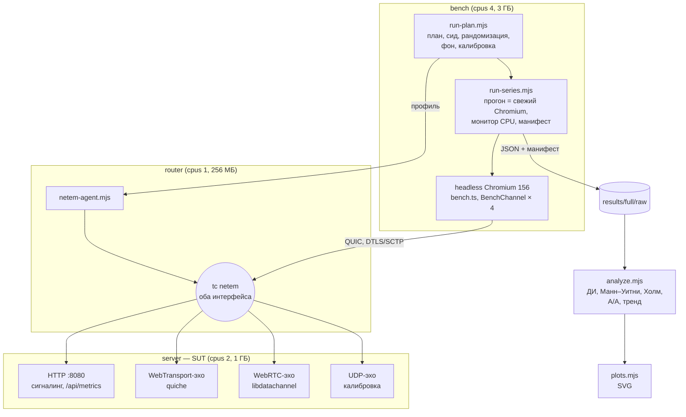
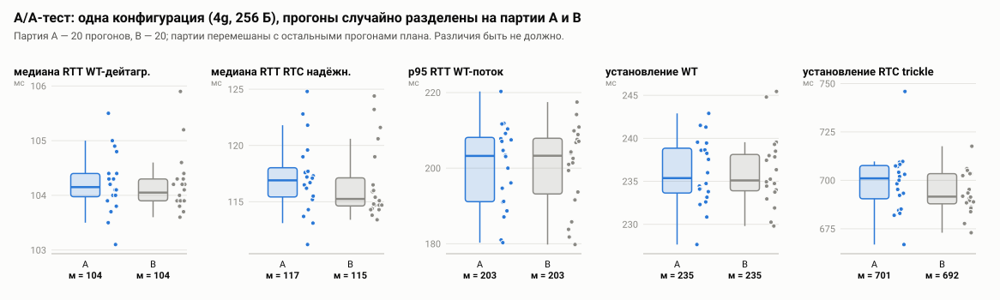
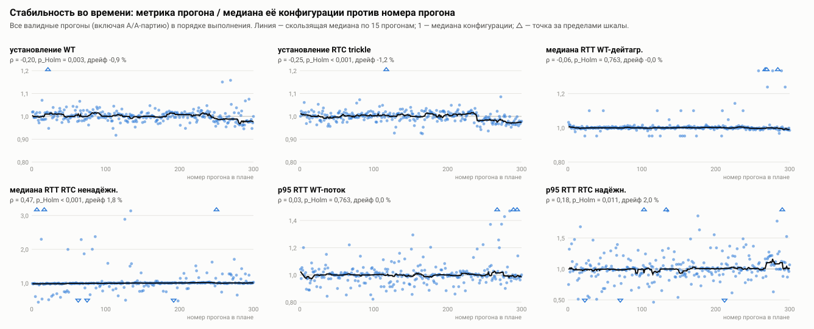
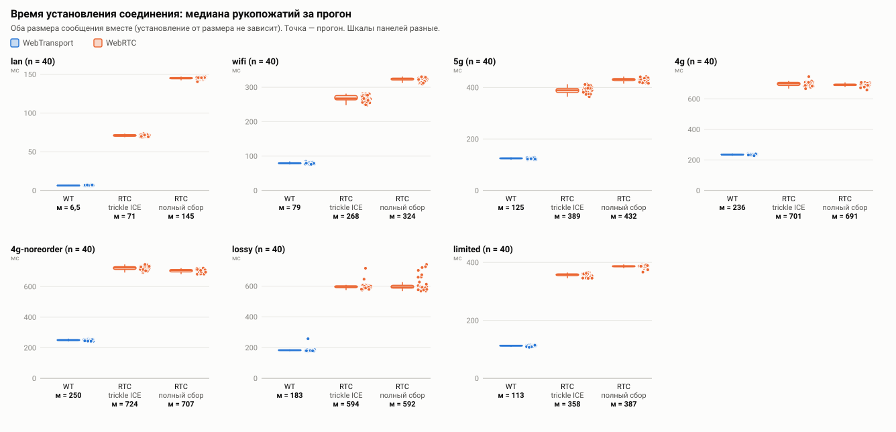
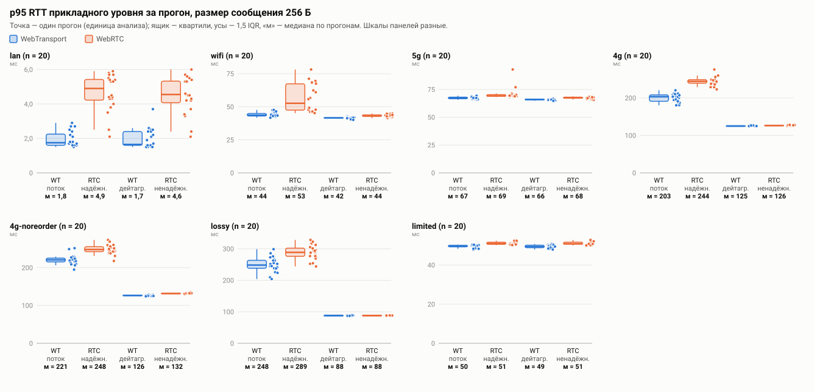
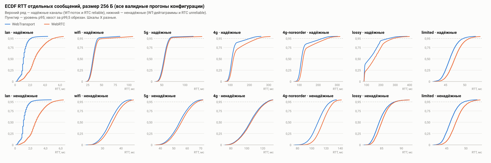
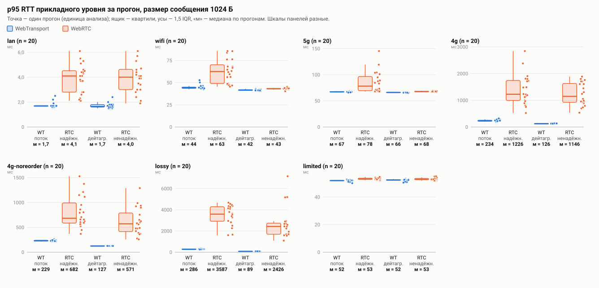
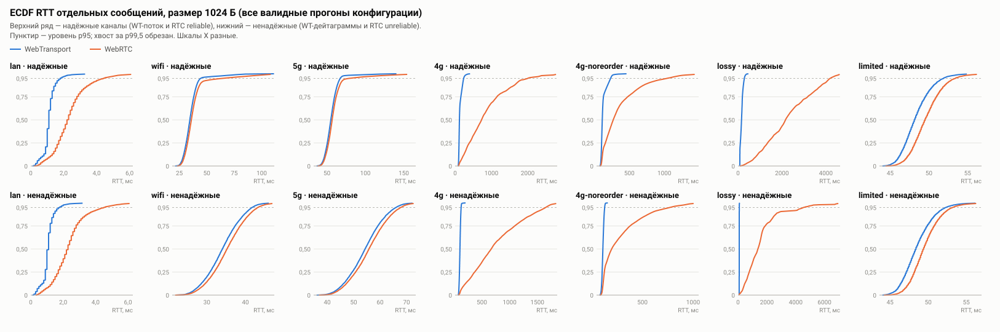

# Практическая работа № 4. Реализация, тестирование и оценка экспериментального стенда

**Тема ВКР:** «Сравнительный анализ технологий WebRTC и WebTransport для передачи
данных в реальном времени в веб-приложениях».
**Артефакт:** репозиторий `rtc-benchmark`
(<https://github.com/HeavenlyGandalf/rtc-benchmark>), ветка
`docs/pr4-experiment`, тег `pr4`.
**Дата:** 05.11.2026.

---

## 1. Исследовательский вопрос, гипотезы и изменения стенда после ПР-3

### 1.1. Напоминание (подробно — раздел 3 отчёта ПР-3)

**RQ.** Как различаются WebRTC DataChannel и WebTransport по времени установления
соединения и по задержке доставки сообщений прикладного уровня (медиана и p95) при
одинаковых контролируемых сетевых условиях в клиент-серверной браузерной архитектуре?

| № | H₁ | Метрика за прогон | Порог практической значимости |
|---|---|---|---|
| H2 | WT устанавливает соединение **быстрее** RTC (основное сравнение — trickle ICE) | медиана времени установления | WT/RTC ≤ 0,75 и разница ≥ 1 RTT профиля (на `lan` ≥ 1 мс) |
| H3 | при потерях p95 RTT надёжного упорядоченного RTC **больше**, чем у ненадёжных каналов (WT-дейтаграммы, RTC unreliable) | p95 RTT | отношение ≥ 1,2 и разница ≥ 16,7 мс |
| H4 | при потерях p95 RTT WT-потока **отличается** от RTC reliable (двусторонняя) | p95 RTT | отношение ≥ 1,2 или ≤ 1/1,2 и разница ≥ 16,7 мс |

H₀ отвергается, только если p после поправки Холма по профилям < 0,05 **и** эффект
выше порога. Единица анализа — прогон. H1 (P2P против ретранслятора) и H5
(масштабируемость) проверяются отдельными сериями и в эту работу не входят
(раздел 8).

### 1.2. Что изменилось по сравнению с проектом ПР-3

| Изменение | Причина |
|---|---|
| Добавлен профиль `4g-noreorder` (`4g` + `rate 1gbit`) — 7 профилей вместо 6, 300 прогонов вместо 260 | В ПР-3 (раздел 6.4) найдено, что джиттер netem на `4g` переупорядочивает 35 % сообщений при шаге 10 мс (и 84 % пакетов при шаге 1 мс в калибровке). Надёжные каналы реагируют на переупорядочивание иначе, чем на потери, поэтому H3/H4 на `4g` нельзя было отнести только к потерям. Обещанный в ПР-3 вариант без переупорядочивания реализован как отдельный уровень фактора |
| Калибровка: для профилей с полосой в ожидание RTT добавлена сериализация кадра; для `4g-noreorder` — свой критерий | Профиль `limited` (5 Мбит/с) в проверочные серии ПР-3 не входил и при первой полной калибровке не прошёл на 0,04 мс: ожидание 2·delay не учитывало 2 × 0,17 мс сериализации. Ошибка была в модели ожидания, а не в эмуляторе; допуск ±2 мс не менялся. Для `4g-noreorder` медиана по построению лежит в [2·delay; 2·(delay + jitter)] (пакет ждёт предыдущий), дополнительно требуется ≤ 0,5 % переупорядоченных пакетов |
| `make smoke` — отдельная дымовая проверка (~2 мин) | Требование ПР-4: сервисы поднимаются, SUT отвечает, метрики собираются. Прежний `verify-smoke` — это сокращённая серия на 15 мин, а не проверка работоспособности |
| В манифест прогона добавлены модель CPU, ОС, RAM хоста и версия Docker | Изнутри контейнера на arm64 модель CPU не читается (`unknown`), а ОС — это VM Docker Desktop. Нашла `make smoke` (раздел 4.1) |
| Проверка стабильности во времени (ρ Спирмена «метрика ~ номер прогона», дрейф) | Требование ПР-4; в ПР-3 дрейф контролировался только рандомизацией и A/A |
| Графики (`scripts/plots.mjs`): ящики с точками прогонов, ECDF RTT, стабильность, A/A | Требование ПР-4; в ПР-3 результаты были только таблицами |
| `make calibrate` ждёт готовности сервера | Калибровка сразу после старта контейнеров теряла 0,2 % пакетов даже на `lan`: сервер в первые секунды компилирует TypeScript. В серии калибровке и так предшествует 10-секундный замер фона, на неё это не влияло |

Пороги, гипотезы, метрики, число повторов и правила анализа не менялись.

---

## 2. Реализация стенда

### 2.1. Архитектура



Все три компонента — контейнеры одного образа `rtc-bench-exp` в Docker Compose
(`experiment/compose-router.yml`), в двух сетях `10.77.1.0/24` и `10.77.2.0/24`.
Трафик клиента к серверу идёт только через маршрутизатор с `tc netem` на обоих
интерфейсах, поэтому RTT ≈ 2·delay профиля. Анализ и графики выполняются на хосте
теми же скриптами Node без внешних зависимостей (их можно запустить и в образе).

Аналоги из шаблона задания: генератор нагрузки (Locust) — `run-series.mjs` +
headless Chromium (нагрузка на браузерный API — сама цель исследования, HTTP-генератор
её не создаст); метрики приложения (Prometheus) — `GET /api/metrics` сервера и
монитор `/proc` клиента, пишутся в манифест по окнам сценариев; конфигурация
(`experiment.yaml`) — `experiment/plan.json` и `profiles.json`; раннер
(`run_experiment.py`) — `run-plan.mjs`; анализ (`analyze.py`) — `analyze.mjs` и
`plots.mjs`. Prometheus и Grafana не используются: метрики нужны не как дашборд, а
как поля в манифесте каждого прогона, по которым анализ бракует прогоны.

### 2.2. Компоненты и версии

| Компонент | Версия | Как зафиксирована |
|---|---|---|
| Базовый образ | `node:22-trixie` (Debian 13.7) | digest `sha256:ead00acb…` в `experiment/Dockerfile` |
| Node.js | 22.23.4 | базовый образ по digest |
| Chromium | 156.0.8078.73 | пакет Debian; версия пишется в манифест каждого прогона, `compare.mjs` предупреждает о другой мажорной версии |
| iproute2 (`tc netem`) | 6.15.0 | пакет Debian; в отчёте |
| Yarn | 4.18.0 | `packageManager` в `package.json` через Corepack |
| WebTransport-сервер | `@fails-components/webtransport` 1.6.8 + quiche 1.6.8 (нативный HTTP/3) | `yarn.lock`, точная версия нативного модуля |
| WebRTC-сервер | `node-datachannel` 0.33.4 (libdatachannel) | `yarn.lock` |
| Управление браузером | `puppeteer-core` 24.43.1 | `yarn.lock` |
| Сборка клиента, TS | esbuild 0.28.2, TypeScript 5.9.3 | `yarn.lock` |
| Образ стенда | `sha256:256196b6ac26…`, собран 04.11.2026 из коммита `88e8dcd` | id образа — в манифест каждого прогона |

**Ограничения ресурсов** (`compose-router.yml`): `bench` — 4 CPU, 3 ГБ, `shm` 1 ГБ;
`server` — 2 CPU, 1 ГБ; `router` — 1 CPU, 256 МБ. Генератор нагрузки и SUT ограничены
раздельно и не делят ядра.

**Машина:** Apple M4 Pro (12 ядер), 24 ГБ, macOS 26.4.1; Docker Desktop 28.4.0, VM
12 vCPU / 7,7 ГБ, ядро 6.10.14-linuxkit, arm64. Всё это — в манифесте каждого прогона.

### 2.3. Как реализованы требования ПР-4

| Требование | Реализация |
|---|---|
| Все компоненты в контейнерах через Docker Compose | `experiment/compose-router.yml`: `bench`, `router`, `server` |
| Версии зафиксированы | базовый образ по digest, `yarn.lock` (`--immutable` в CI), версии в таблице 2.2 и в манифесте |
| Запуск одной командой | `make experiment` (полный план → анализ → графики); `make verify` — сокращённый план со сверкой с эталоном |
| Параметры в конфигурации | `experiment/plan.json`: сид 20261103, факторы и уровни, 20 повторов, A/A-партия, прогрев, параметры прогона; `profiles.json` — сетевые профили |
| Сырые данные и манифест каждого прогона | `results/full/raw/<run-id>.json`: все RTT сообщений и все рукопожатия + манифест (коммит, флаг `gitDirty`, id образа, версии, сид, номер в плане, параметры netem, характеристики машины, лимиты, время, загрузка CPU по окнам) |
| Анализ скриптом | `scripts/analyze.mjs`, `scripts/plots.mjs`; статистика — `scripts/lib/stats.mjs` с модульными тестами |
| A/A-тест, генератор не узкое место | раздел 4 |
| README для постороннего | раздел 0 `README.md` |
| CI (бонус) | `.github/workflows/ci.yml`: typecheck, тесты статистики, эхо-тесты, сборка образа и `make verify-smoke` (2 профиля × 3 прогона + A/A, сверка знаков выводов), артефакт с сырыми данными и графиками |

### 2.4. План эксперимента

| Параметр | Значение |
|---|---|
| Факторы между прогонами | профиль (7): `lan`, `wifi`, `5g`, `4g`, `4g-noreorder`, `lossy`, `limited`; размер сообщения (2): 256 и 1024 Б |
| Факторы внутри прогона | канал (4): WT-поток, WT-дейтаграммы, RTC reliable, RTC unreliable; режим ICE (2): полный сбор, trickle |
| Повторы | 20 прогонов на конфигурацию (14 конфигураций) + A/A-партия B: 20 прогонов `4g`/256 Б → 300 прогонов |
| Внутри прогона | 30 рукопожатий на вариант установления (+1 отбрасываемое); 1000 сообщений RTT с шагом 10 мс (+50 прогревочных); 10 с пропускной способности на канал |
| Прогрев | отбрасываемый первый прогон серии; прогревочные рукопожатия и сообщения внутри прогона; пауза 2 с после смены профиля |
| Порядок | все 300 прогонов перемешаны сидом 20261103; порядок каналов и вариантов установления внутри прогона — сидом прогона |
| Изоляция прогонов | каждый прогон — новый процесс Chromium и новые соединения; соединения закрываются после каждого сценария |

**Решение о «тёплом» сервере.** Шаблон задания пересоздаёт SUT перед каждым прогоном.
Здесь сервер не перезапускается, а пересоздаётся всё, что относится к измеряемому
объекту, — соединения и браузер. Причины: (1) в реальном приложении WebTransport- и
WebRTC-серверы долгоживущие, и холодный старт Node с компиляцией TypeScript
(≈ 5 с, раздел 1.2) мерил бы не транспорт; (2) накопление состояния контролируется:
RSS и загрузка сервера пишутся по окнам каждого прогона, а проверка стабильности
(раздел 4.5) ищет дрейф метрик по ходу серии. Проверка нашла слабый дрейф RTT RTC (+2 %) и рост памяти сервера: тёплое
состояние почти не смещает сравнение профилей, но немного смещает сравнение WT и RTC (разделы 4.5 и 5.3).

---

## 3. Воспроизведение

Пошаговая инструкция — раздел 0 `README.md`. Кратко:

```bash
git clone https://github.com/HeavenlyGandalf/rtc-benchmark.git
```

```bash
cd rtc-benchmark && git checkout pr4 && make image && make smoke && make experiment
```

Нужны Docker с Compose v2 (≥ 7 свободных ядер, ≥ 5 ГБ RAM для VM), `make` и
Node ≥ 20 на хосте. Полная серия идёт около 14 ч; сокращённая со сверкой с эталоном
(`make verify`) — 75 мин. Результаты — `results/full/` (сырые данные, манифесты,
`analysis.md`, `plots/`). Повторный анализ сохранённых данных без Docker:
`make analyze NAME=full`.

---

## 4. Тестирование стенда

Серия `results/full` выполнена 04–05.11.2026 одной командой `make experiment`:
300 прогонов из 300, упавших и повторённых нет (`failures.json`), все 300 прошли
проверку валидности. Длительность — 14,0 ч (медиана 2,6 мин на прогон). Анализ в
контейнере (`analyze.mjs` из коммита образа `88e8dcd`) и повторный анализ на хосте
(коммит с тегом `pr4`) дали одинаковые таблицы; повторный анализ добавляет только
проверку стабильности (раздел 4.5), которой в образе ещё не было.

### 4.1. Дымовой тест

`make smoke` (≈ 2 мин) поднимает топологию и проверяет её по 11 пунктам. Пройден
04.11 перед серией и 05.11 после неё (лог — `results/full/smoke-check.log`):

| Проверка | Результат 05.11 |
|---|---|
| маршрутизатор: `netem-agent` `/health` | PASS |
| сервер: `/api/info` (адрес WT-эха) | PASS |
| сервер: `/api/metrics` | PASS — CPU 13,2 %, p99 event loop 3,93 мс |
| netem: калибровка `lan` и `4g` через маршрутизатор | PASS |
| прогон `run-series` завершился | PASS |
| RTT по 4 каналам | PASS |
| время установления WT и RTC | PASS |
| пропускная способность | PASS |
| монитор CPU клиента (`/proc`) | PASS — p95 5,3 % лимита |
| CPU и event loop сервера по окнам | PASS |
| манифест: коммит, образ, хост, лимиты | PASS — `88e8dcd`, `sha256:256196b6ac26`, Apple M4 Pro / macOS 26.4.1 / Docker 28.4.0, 4 CPU / 3072 МБ |

Дымовой тест сам нашёл две проблемы при разработке: модель CPU в манифесте была
`unknown` (исправлено, раздел 1.2), а калибровка `lan` на 2000 пакетов давала ложный
сбой (0,2 % потерь — 4 пакета, потерянных сразу после старта сервера) — теперь
используется та же калибровка на 10⁴ пакетов, что и в серии, с паузой после
готовности сервера. Запас всё равно невелик: 05.11 потери на `lan` были 0,12 % при
допуске 0,20 %. Лог за 04.11 не сохранён (вывод шёл в терминал).

### 4.2. Калибровка сети

Перед серией — UDP-эхо, 10⁴ пакетов с шагом 1 мс через маршрутизатор. Все 7 профилей
в допусках:

| Профиль | Медиана RTT, мс | Ожидание, мс | Потери, % | Ожидание, % | Переупорядочено, % |
|---|---|---|---|---|---|
| `lan` | 0,04 | −2…2 | 0,02 | 0,00 ± 0,20 | 0 |
| `wifi` | 31,04 | 28…32 | 0,97 | 1,00 ± 0,50 | 67,4 |
| `5g` | 50,93 | 48…52 | 0,34 | 0,40 ± 0,39 | 76,3 |
| `4g` | 100,94 | 98…102 | 2,06 | 1,99 ± 0,62 | 83,5 |
| `lossy` | 80,40 | 78…82 | 9,58 | 9,75 ± 1,09 | 0 |
| `limited` | 41,36 | 38,34…42,34 | 0,01 | 0,00 ± 0,20 | 0 |
| `4g-noreorder` | 120,00 | 100…130 | 2,21 | 1,99 ± 0,62 | **0** |

`4g-noreorder` действительно убирает переупорядочивание (83,5 % → 0 %), но ценой
более высокой задержки (раздел 7).

### 4.3. A/A-тест

Партия B — 20 прогонов `4g`/256 Б, перемешанных с остальными 280 и неотличимых от
партии A ничем, кроме метки. Тест пройден по всем пяти метрикам:

| Метрика | A/B [95 % ДИ] | p (Манн–Уитни) |
|---|---|---|
| медиана RTT, WT-дейтаграммы | 1,001 [0,998; 1,004] | 0,52 |
| медиана RTT, RTC reliable | 1,014 [0,999; 1,024] | 0,23 |
| p95 RTT, WT-поток | 1,000 [0,946; 1,040] | 1,00 |
| время установления WT | 1,001 [0,986; 1,017] | 0,85 |
| время установления RTC (trickle) | 1,014 [0,994; 1,024] | 0,19 |

Все ДИ содержат 1, расхождение точечных оценок ≤ 1,4 %. По сравнению с A/A серии 1
ПР-3 (10 + 10 прогонов) ДИ стали уже в 1,3–3,3 раза: например, p95 WT-потока —
[0,946; 1,040] против [0,899; 1,059]. На графике `aa.svg` видно, что точки партий
перекрываются.



### 4.4. Генератор нагрузки — не узкое место

Генератор здесь — headless Chromium в контейнере `bench` (лимит 4 CPU). Монитор
`/proc` пишет загрузку по окнам каждого сценария; критерий задания — < 80 %.

| Величина (худший прогон серии) | Значение | Порог браковки в `analyze.mjs` |
|---|---|---|
| CPU клиента, p95 за окна установления и RTT | **8,5 %** лимита | 70 % |
| самый загруженный процесс Chromium, p95 | 17,0 % ядра | 90 % |
| CPU клиента, p95 за окно пропускной способности, профили с задержкой | максимум 9,0 % лимита | — |
| то же, `lan` (375 Мбит/с по WT-потоку) | медиана 51 %, максимум **57,7 %** лимита | — |
| CPU сервера (все потоки, среднее за окна установления и RTT) | 17,2 % ядра (лимит 2 ядра) | 70 % |
| CPU сервера, окно пропускной способности, профили с задержкой | максимум 21,5 % ядра | — |
| то же, `lan` | максимум **143 % ядра** (≈ 72 % лимита в 2 ядра) | — |
| p99 задержки event loop сервера, окна установления и RTT | 7,63 мс | 16,7 мс |
| то же, окно пропускной способности `lan` | до 11,2 мс | — |
| фон сервера в простое | 2,7 % CPU, p99 event loop 3,98 мс | — |

В сценариях, по которым проверяются гипотезы (установление и RTT), генератор
загружен меньше чем на 10 %, сервер — меньше чем на 20 % ядра. Ближе всего к
пределу — сценарий пропускной способности на `lan`: клиент занят на 58 % лимита,
сервер — на 72 %. Нагружены обе стороны, и какая из них ограничивает, по этим
данным сказать нельзя. Поэтому абсолютные числа пропускной способности на `lan` —
свойство стенда, а не транспорта, и в гипотезах не используются. Отдельный контроль:
p95 CPU клиента не меняется между профилями (3–5 % лимита), то есть рост задержек на
`4g` и `lossy` не вызван нагрузкой генератора.

### 4.5. Стабильность во времени

Для каждой метрики значение прогона делится на медиану его конфигурации (профиль ×
размер), и получившийся ряд проверяется против номера прогона в плане: ρ Спирмена с
перестановочным p (10⁴ перестановок, поправка Холма по 10 метрикам) и дрейф — медиана
последней трети плана, делённая на медиану первой, минус 1. Тренд засчитывается,
если p_Holm < 0,05 **и** |дрейф| ≥ 5 %. Порог 5 % выбран до просмотра результатов
полной серии (код проверки написан во время её выполнения), но не был заявлен в
ПР-3, поэтому строго это не предрегистрация. Обоснование: 5 % — это около трети
наименьшего порога практической значимости (16,7 %, H4) и порядок шума p95 WT-потока
(IQR 4 %). При n = 300 статистически значимым становится и дрейф в доли процента:
здесь p_Holm < 0,05 у 6 метрик из 10.

| Метрика | ρ | p_Holm | Дрейф, % | IQR нормированной метрики | Тренд |
|---|---|---|---|---|---|
| установление WT | −0,20 | 0,003 | −0,9 | 0,027 | нет |
| установление RTC (trickle) | −0,25 | < 0,001 | −1,2 | 0,028 | нет |
| медиана RTT, WT-поток | −0,07 | 0,76 | −0,1 | 0,013 | нет |
| p95 RTT, WT-поток | 0,03 | 0,76 | 0,0 | 0,041 | нет |
| медиана RTT, WT-дейтаграммы | −0,06 | 0,76 | 0,0 | 0,007 | нет |
| p95 RTT, WT-дейтаграммы | −0,10 | 0,38 | −0,2 | 0,012 | нет |
| медиана RTT, RTC reliable | 0,36 | < 0,001 | +2,3 | 0,034 | нет |
| p95 RTT, RTC reliable | 0,18 | 0,011 | +2,0 | 0,145 | нет |
| медиана RTT, RTC unreliable | 0,47 | < 0,001 | +1,8 | 0,021 | нет |
| p95 RTT, RTC unreliable | 0,40 | < 0,001 | +1,8 | 0,024 | нет |



**Итог: значимого по правилу тренда нет, но есть два слабых систематических
эффекта, о которых нужно сказать.**

1. *RTT WebRTC медленно растёт* (+1,8…2,3 % за 14 ч), у WebTransport дрейфа нет.
   Параллельно **растёт RSS сервера: 203 МБ в первом прогоне, плато ≈ 340–360 МБ в
   середине серии, 427 МБ в последнем** (наклон по МНК ≈ 0,6 МБ на прогон). Рост не
   монотонный: после сценария пропускной способности на `lan` RSS скачком поднимается
   до **707 МБ (69 % лимита 1 ГБ)** и затем частично снижается. Возможны два
   объяснения: буферы, занятые на 375 Мбит/с и возвращаемые системе не полностью, или
   утечка объектов `node-datachannel` (60+ соединений RTC на прогон). Какое из них
   верно, по этим данным не определить. Дрейф RTT в 2 % затрагивает только каналы RTC;
   для H2 и H3 (эффекты в разы) он несуществен, но для H4 на `4g` — существен
   (раздел 5.3). Это прямое следствие решения о «тёплом» сервере (раздел 2.4); причину
   нужно установить в ВКР (раздел 8).
2. *Время установления слегка падает* (−1 %), одинаково у WT и RTC — вероятно,
   прогрев хоста, на отношения по H2 не влияет.

**Инцидент: сон хоста.** В 10:13 крышку ноутбука закрыли при работе от батареи, и
macOS перешла в сон, несмотря на `caffeinate` (журнал `pmset`). Сон пришёлся на
прогоны 240 (`wifi`/1024) и 241 (`4g-noreorder`/1024): они длились 28 и 23 мин
вместо ~2,5. Внутри прогонов выбросов, сопоставимых со временем сна, нет (часы
гостевой VM на время сна останавливаются), их медианы и p95 лежат внутри разброса
своих конфигураций. Анализ без этих двух прогонов дал **те же решения по всем 29
проверкам гипотез**, A/A и стабильности; изменилось одно отношение во втором знаке
(H2-trickle на `4g-noreorder`: 0,35 → 0,34). Прогоны оставлены в данных; в README
добавлено требование держать ноутбук на питании с открытой крышкой.

### 4.6. Повторяемость между сериями

Повторяемость проверялась в ПР-3 тремя сериями `make verify` (40 прогонов, `lan`,
`4g`, `lossy`) на двух образах: H2 и H3 совпали во всех трёх. Теперь полная серия
сверена с эталоном (серия 1 ПР-3, другой коммит и образ) той же программой
`compare.mjs` — **31 из 35 проверок** (`results/full/compare-reference.txt`; полный лог серии — `results/full/run.log.gz`):

| Группа | Итог |
|---|---|
| калибровка, валидность, A/A | PASS |
| решения по H2 и H3 на `lan`, `4g`, `lossy` (10 проверок) | все совпали |
| отношения A/B по H2–H4 на `4g` и `lossy` (10 проверок) | ДИ пересекаются, например H3 на `lossy`: 3,27 [3,13; 3,38] против 3,16 [3,04; 3,41] |
| медианы RTT на `4g` и `lossy` (8 проверок) | отклонение −0,2…−5,6 %, допуск ±10 % |
| решение по H4 на `4g` и на `lossy` | **не совпали** (2 FAIL) |
| отношение H2 на `lan` (trickle и full) | **ДИ не пересекаются** (2 FAIL): 0,09 против 0,12 и 0,04 против 0,06 |

*H4* — ожидаемый результат: в ПР-3 (раздел 6.5) показано, что эффект лежит у порога
0,833 и решение зависит от серии. Отношения по всем четырём сериям:

| Профиль | ПР-3, серия 1 | ПР-3, серия 2 | ПР-3, серия 3 | **ПР-4 (20 прогонов)** |
|---|---|---|---|---|
| `4g` | 0,87 [0,75; 0,90] | 0,86 [0,73; 0,95] | 0,81 [0,74; 0,87] | **0,83 [0,79; 0,86]** |
| `lossy` | 0,81 [0,74; 0,95] | 0,84 [0,68; 0,94] | 0,75 [0,66; 0,88] | **0,86 [0,82; 0,93]** |

Направление не менялось ни разу (все ДИ ниже 1), а на 20 прогонах ДИ сузились
примерно вдвое. Порог проходит через ДИ, поэтому окончательный вывод — «на `4g` и
`lossy` эффект 14–17 %, на границе практической значимости» (раздел 5.3).

*H2 на `lan`* — расхождение в абсолютных миллисекундах: медиана времени установления
WT на `lan` при 256 Б — 6,7 мс против 7,7–8,3 мс во всех трёх сериях ПР-3. RTC не
изменился (71,8 против 70,3–71,4 мс). Код измерения в браузере и на сервере между
образами не менялся: `git diff 81bf791..88e8dcd` затрагивает калибровку, манифест,
дымовой тест, план, запись повторов в оркестраторе и профили netem. Сдвиг в 1,0–1,6 мс на величине в
несколько миллисекунд — это планирование потоков в VM, а отношение «маленькое /
большое» усиливает его до 25 %. Вывод H2 на `lan` (WT быстрее в 11–22 раза) от этого не
меняется. Вывод для методики: на `lan` сверять нужно разность в миллисекундах, а не
отношение (раздел 8).

---

## 5. Результаты эксперимента

Все таблицы — `results/full/analysis.md` и `summary.csv` (медиана по прогонам с 95 %
бутстреп-ДИ). Единица анализа — прогон; в каждой ячейке n = 20 прогонов (для H2 —
40, так как время установления от размера сообщения не зависит, и оба размера
объединены). Поправка Холма — по профилям внутри каждой гипотезы.

### 5.1. Время установления соединения (H2)

| Профиль | WT, мс | RTC trickle, мс | RTC full, мс | WT/RTC trickle [95 % ДИ] | δ Клиффа | H₀ |
|---|---|---|---|---|---|---|
| `lan` | 6,5 | 71,1 | 145,3 | 0,09 [0,09; 0,09] | −1,00 | отвергнута |
| `wifi` | 79,3 | 267,8 | 324,4 | 0,30 [0,29; 0,30] | −1,00 | отвергнута |
| `5g` | 124,9 | 389,0 | 431,7 | 0,32 [0,32; 0,33] | −1,00 | отвергнута |
| `limited` | 112,9 | 358,3 | 386,8 | 0,32 [0,31; 0,32] | −1,00 | отвергнута |
| `lossy` | 183,1 | 594,3 | 592,2 | 0,31 [0,31; 0,31] | −1,00 | отвергнута |
| `4g` | 235,5 | 701,3 | 690,8 | 0,34 [0,33; 0,34] | −1,00 | отвергнута |
| `4g-noreorder` | 249,8 | 723,8 | 706,7 | 0,35 [0,34; 0,35] | −1,00 | отвергнута |

p_Holm < 0,001 во всех профилях; δ = −1 означает, что **любой** прогон WT быстрее
любого прогона RTC. Для full ICE отношения 0,04–0,35, выводы те же.

**Механизм** (линейная регрессия медиан по `lan`, `wifi`, `5g`, `4g` против медианы
RTT WT-дейтаграмм как измеренного RTT при темпе сообщений): WT ≈ 2,2·RTT + 4 мс — QUIC-рукопожатие (1 RTT) и CONNECT HTTP/3 (1 RTT);
RTC trickle ≈ 6,1·RTT + 62 мс — сигналинг по HTTP, проверки ICE, DTLS (2 RTT),
SCTP INIT/COOKIE (2 RTT) и открытие канала; RTC full ≈ 5,3·RTT + 143 мс, где
постоянные ≈ 130 мс — ожидание завершения сбора кандидатов (фаза offer в
`analysis.md`). Поэтому выигрыш WT растёт с RTT в абсолюте (65 мс на `lan`, 466 мс на
`4g`), а отношение стабилизируется около 1/3 ≈ 2,2 / 6,1.



### 5.2. Хвост задержки при потерях: надёжный против ненадёжных каналов (H3)

H3 проверяется только в профилях с потерями, размер сообщения 256 Б.

| Профиль | p95 RTC reliable, мс | p95 WT-дейтагр., мс | p95 RTC unrel., мс | отношение к WT-дейтагр. [ДИ] | разность, мс | δ | H₀ |
|---|---|---|---|---|---|---|---|
| `5g` (0,2 %) | 69,2 | 65,9 | 67,5 | 1,05 [1,04; 1,07] | 3,3 | 1,00 | **не** отвергнута — эффект ниже порога |
| `wifi` (0,5 %) | 52,6 | 41,5 | 43,5 | 1,27 [1,15; 1,56] | 11,1 | 1,00 | **не** отвергнута — разность < 16,7 мс |
| `4g` (1 %, с переупоряд.) | 244,4 | 125,1 | 126,4 | 1,95 [1,92; 1,98] | 119 | 1,00 | отвергнута |
| `4g-noreorder` (1 %) | 247,9 | 126,4 | 131,9 | 1,96 [1,92; 2,01] | 122 | 1,00 | отвергнута |
| `lossy` (5 %) | 288,7 | 88,4 | 88,4 | 3,27 [3,13; 3,38] | 200 | 1,00 | отвергнута |

H3 подтверждается при потерях от 1 % на проход: p95 надёжного упорядоченного канала
в 1,9–3,3 раза больше, чем у ненадёжных (обоих — WT и RTC, отношения к ним почти
совпадают). При 0,2–0,5 % потерь эффект статистически есть (δ = 1), но меньше
порога практической значимости. Медиана при этом почти не меняется (на `4g`
116,9 против 104,2 мс): потеря задерживает не все сообщения, а только хвост — те,
что ждут повторной передачи и стоят за ней в очереди (блокировка «голова очереди»).

**`4g` против `4g-noreorder`.** Отношение по H3 одинаково (1,95 и 1,96), значит
эффект на `4g` создают потери, а не переупорядочивание — сомнение, оставленное в
ПР-3 (раздел 6.4), снято.





### 5.3. Надёжный поток WT против надёжного канала RTC (H4)

| Профиль | p95 WT-поток, мс | p95 RTC reliable, мс | отношение [ДИ] | разность, мс | δ | H₀ |
|---|---|---|---|---|---|---|
| `5g` | 67,3 | 69,2 | 0,97 [0,96; 0,98] | −1,9 | −0,89 | не отвергнута |
| `wifi` | 43,7 | 52,6 | 0,83 [0,67; 0,92] | −8,9 | −0,91 | не отвергнута (разность < 16,7 мс) |
| `4g` | 203,3 | 244,4 | 0,83 [0,79; 0,86] | −41 | −1,00 | **отвергнута** |
| `4g-noreorder` | 220,6 | 247,9 | 0,89 [0,86; 0,92] | −27 | −0,83 | не отвергнута (отношение > 0,833) |
| `lossy` | 248,2 | 288,7 | 0,86 [0,82; 0,93] | −40 | −0,76 | не отвергнута (отношение > 0,833) |

Во всех пяти профилях WT-поток имеет **меньший** p95, чем RTC reliable (p_Holm < 0,001,
δ от −0,76 до −1). Эффект — 11–17 % на профилях с потерями от 0,5 % и 3 % на `5g`;
порог 1/1,2 = 0,833 проходит по краю или внутри ДИ.

Формально H₀ отвергнута только на `4g`, но это решение **неустойчиво**: отношение
203,3 / 244,4 = 0,8318 при пороге 0,8333, запас — 0,2 %. Это меньше дрейфа RTT RTC
за серию (до +2 %, раздел 4.5), который увеличивает только знаменатель. Перемешивание
конфигураций такой дрейф не компенсирует: он одинаково смещает все прогоны RTC.

На `4g` отношение ниже, чем на `4g-noreorder` (0,83 против 0,89). Это согласуется с
гипотезой, что переупорядочивание вредит SCTP сильнее, чем QUIC. Но профили
различаются и базовой задержкой (раздел 7), так что это гипотеза, а не вывод.

Итоговая формулировка: **на профилях с потерями от 0,5 % надёжный поток WebTransport
даёт хвост задержки на 11–17 % меньше, чем надёжный канал WebRTC. Направление
устойчиво во всех профилях и четырёх сериях, а величина лежит на границе принятого
порога практической значимости.**

### 5.4. Разведочный результат: сообщения 1024 Б

Размер 1024 Б входил в план как фактор, но гипотезы H3/H4 заранее были
сформулированы для 256 Б, поэтому ниже — описательные результаты без проверки.

| Профиль | Медиана RTT, мс (WT-дейтагр. / RTC unrel. / WT-поток / RTC rel.) | p95 RTT RTC rel., мс | Потери RTC unrel., % | Пропускная способность RTC rel., Мбит/с |
|---|---|---|---|---|
| `wifi` | 34 / 35 / 35 / 36 | 62 | 0,9 | 2,3 |
| `5g` | 54 / 56 / 55 / 57 | 78 | 0,4 | 1,4 |
| `4g-noreorder` | 109 / **175** / 114 / **272** | 682 | 2,3 | 0,9 |
| `4g` | 105 / **695** / 119 / **748** | 1226 | 6,6 | 0,6 |
| `lossy` | 84 / **1447** / 161 / **2137** | 3587 | 27,4 | 0,5 |

При 1024 Б с шагом 10 мс приложение отправляет ≈ 0,82 Мбит/с. На `4g` и `lossy`
управление перегрузкой SCTP в WebRTC (по сценарию пропускной способности —
0,5–0,6 Мбит/с при 1–5 % случайных потерь) не успевает за этим темпом: сообщения
копятся в буфере отправителя, и задержка растёт до секунд **даже на ненадёжном
канале**: ненадёжный канал WebRTC (частично надёжный SCTP) отменяет только повторные
передачи, но по-прежнему подчиняется управлению перегрузкой SCTP-ассоциации.
Видимые потери RTC unreliable (6,6 и 27 %) выше сетевых — вероятно, это сообщения,
не дождавшиеся отправки до конца замера (проверить по счётчикам буфера в ВКР). WebTransport-дейтаграммы этого эффекта не показывают
(105 и 84 мс — как при 256 Б): QUIC-соединение на тех же профилях держит
0,9–1,3 Мбит/с (на `4g-noreorder` — до 2,3). На `4g` эффект в 4 раза сильнее, чем на
`4g-noreorder` (695 против 175 мс у RTC unreliable). Вероятное объяснение — SCTP
принимает переупорядочивание за потери и сокращает окно, но это гипотеза: профили
различаются и задержкой.

Это самый сильный практический результат серии: **для потока сообщений,
приближающегося к ~1 Мбит/с в сети с потерями 1–5 %, ненадёжный канал WebRTC
перестаёт быть каналом с низкой задержкой, а дейтаграммы WebTransport — нет.** Его
нужно проверить в ВКР как отдельную гипотезу с варьированием темпа отправки
(раздел 8).





### 5.5. Сводка решений

| Гипотеза | Решение | Где отвергнута H₀ | Размер эффекта |
|---|---|---|---|
| H2: WT устанавливает соединение быстрее | **подтверждена** | все 7 профилей | WT/RTC 0,09–0,35, δ = −1 |
| H3: при потерях p95 надёжного RTC больше ненадёжных каналов | **подтверждена при потерях ≥ 1 %** | `4g`, `4g-noreorder`, `lossy` | 1,9–3,3×, δ = 1 |
| H4: p95 WT-потока отличается от RTC reliable | **направление устойчиво, величина на пороге** | `4g` (запас 0,2 %, неустойчиво) | 0,83–0,89 при потерях ≥ 0,5 %, 0,97 на `5g`; δ = −0,76…−1 |

---

## 6. Оценка результатов и сравнение со статьями

**Правдоподобность.** Результаты согласуются с устройством протоколов, а не только
между собой: (1) коэффициент 2,2 RTT у WT и ≈ 6 RTT у RTC соответствуют числу обменов
в рукопожатиях; (2) медианы RTT близки к RTT калибровки (101 мс UDP-эха на `4g`): у ненадёжных
каналов +3–4 мс (обработка в браузере и стеке), у надёжных +8–16 мс за счёт
повторных передач;
(3) потери ненадёжных каналов на 256 Б совпадают с потерями калибровки (1,9 % на
`4g` при ожидании 1,99 %); (4) переупорядочивание не меняет H3 — так и должно быть,
если хвост определяется повторными передачами.

**Сравнение со статьями** (нумерация — как в ПР-3):

| Работа | Что там | Что здесь | Согласие |
|---|---|---|---|
| [1] Pham et al. | Ставит вопрос, достигает ли WT (MoQ) сквозной задержки уровня WebRTC в live-стриминге (полный текст недоступен, ПР-3, раздел 2; сравниваю с постановкой, а не с числами) | По RTT сообщений при малой нагрузке WT-дейтаграммы и RTC unreliable практически совпадают (104 и 105 мс на `4g`) | На уровне сообщений ответ «да, сопоставимы»; дополнение — WT выигрывает в установлении (в 3 раза) и под нагрузкой ~1 Мбит/с с потерями (раздел 5.4) |
| [2] Zhang et al. | QUIC медленнее TCP на быстрых каналах (полоса до 1 Гбит/с) из-за обработки у получателя | На `lan` WT-поток даёт 375 Мбит/с, при этом клиент загружен на 58 % лимита, а сервер — на 72 %: обработка QUIC на конечных узлах дорогая | Согласуется качественно, но узкое место (клиент или сервер) здесь не локализовано; абсолютные числа `lan` — свойство стенда (раздел 4.4) |
| [3] Engelbart, Ott | Исследует, как сочетать медиа-CC (SCReAM) с управлением перегрузкой QUIC для RTP поверх QUIC-дейтаграмм (полный текст недоступен, сравнение — по постановке и репозиторию) | WT-дейтаграммы под CC QUIC держат 0,82 Мбит/с без роста задержки, SCTP-канал WebRTC — нет | Подтверждает актуальность вопроса [3]: управление перегрузкой транспорта определяет задержку даже ненадёжной доставки. Где CC QUIC станет узким местом для дейтаграмм — вопрос серии с темпом отправки |
| [5] Kakhki et al. | QUIC чувствителен к переупорядочиванию (порог NACK = 3 принимает его за потери) | Переупорядочивание на `4g` снижает пропускную способность WT-потока с 2,0–2,3 до 0,9 Мбит/с; у SCTP — с 0,8–0,9 до 0,6 | **Воспроизводит** эффект [5] на современном Chromium; задержку при малой нагрузке (H3) переупорядочивание при этом почти не меняет |
| [6] Jansen et al. | WebRTC (GCC) деградирует при потерях и ограниченной полосе | Канал данных WebRTC (SCTP, не GCC) при 1–5 % потерь держит лишь 0,5–0,6 Мбит/с | Согласуется по направлению; у [6] медиа-путь, здесь — канал данных |
| [7] Sh3b0 | При 15 % потерь сравнивается доставка потока сообщений в надёжном и ненадёжном режимах (метрика — доля доставленных, задержка операционально не определена); число прогонов не указано | H3: при 5 % потерь p95 надёжного в 3,3 раза больше ненадёжных; 20 прогонов, ДИ, δ | Согласуется по направлению (надёжный режим расплачивается за потери); здесь — количественная оценка задержки и статистика, которых в [7] нет |

С [4] прямого сравнения нет: там закрытые клиенты видеосвязи, метрика — битрейт и
качество видео.

**Чем результаты отличаются от литературы.** Работ, где WebRTC DataChannel и
WebTransport сравниваются по времени установления и хвосту задержки на одном
сервере, в одном браузере и с откалиброванной эмуляцией сети, не найдено (обзор ПР-3).
Новое здесь — количественный размер эффектов H2–H4 с ДИ и разведочный результат о
том, что SCTP-ассоциация ограничивает и ненадёжный канал WebRTC.

---

## 7. Угрозы валидности и ограничения

| Тип | Угроза | Что сделано / что осталось |
|---|---|---|
| Внутренняя | Дрейф состояния «тёплого» сервера | Проверка стабильности: тренда по правилу нет, но RTT RTC растёт на ~2 %, RSS сервера 203 → 427 МБ с пиками до 707 МБ после `lan`-throughput. Перемешивание защищает сравнения конфигураций, но не сравнения WT и RTC: решение по H4 на `4g` лежит в пределах дрейфа. Причину роста RSS нужно установить (раздел 8) |
| Внутренняя | Сон хоста в середине серии | Два прогона затронуты; анализ без них — те же решения (раздел 4.5). В README — питание и открытая крышка |
| Внутренняя | Посторонняя нагрузка на хосте | Во время серии в Docker работал посторонний контейнер (`qdrant`, без нагрузки от стенда). Его влияние не измерялось; косвенно — фон сервера в простое 2,7 % CPU, CPU клиента ≤ 8,5 % лимита, A/A пройден, тренда по правилу нет. В README — запускать серию без посторонних контейнеров |
| Внутренняя | Каналы внутри прогона не независимы, а Манн–Уитни их так рассматривает | Порядок каналов внутри прогона рандомизирован сидом; для H2–H4 δ = ±1 почти везде, то есть вывод не зависит от выбора теста. В ВКР — парный тест Уилкоксона по прогонам как проверка устойчивости |
| Конструктная | `4g-noreorder` отличается от `4g` не только переупорядочиванием: `rate` превращает джиттер в очередь, и задержка выше (медиана калибровки 120 против 101 мс) | Профили сравниваются по измеренным медианам; вывод «H3 на `4g` — от потерь» опирается на совпадение отношений, а не абсолютных значений |
| Конструктная | Переупорядочивание 67–83 % на профилях с джиттером нереалистично для реальных сетей | Для выводов о хвосте используются `lossy` и `4g-noreorder`; реальные трассы — в ВКР |
| Конструктная | Пропускная способность на `lan` ограничена CPU клиента и сервера (58 и 72 % лимитов), а не транспортом | Числа `lan` не используются в гипотезах (раздел 4.4) |
| Внешняя | Один браузер (Chromium 156), одна серверная реализация каждого транспорта (quiche, libdatachannel) | Результаты относятся к этой паре реализаций; другие браузеры и Go-реализации — в ВКР |
| Внешняя | Эмуляция netem вместо реальной сети; одна машина (Apple M4 Pro, Docker Desktop, arm64) | Калибровка подтверждает параметры эмуляции; повтор на Linux-хосте x86 — в ВКР |
| Статистическая | Пороговые решения неустойчивы около порога (H4) | 20 прогонов вместо 10 сузили ДИ вдвое; H4 формулируется через величину эффекта, а не через бинарное решение |
| Статистическая | Результаты для 1024 Б — разведочные, без поправки на множественность | Отмечены как разведочные; проверка — отдельной заранее заявленной гипотезой |
| Повторяемость | Отношение H2 на `lan` не совпало с эталоном ПР-3 (сдвиг 1,0–1,6 мс) | Решение совпало; критерий сверки на `lan` нужно перевести на разность в мс |
| Инструментальная | Анализ в образе `88e8dcd` не включает проверку стабильности | Итоговый анализ пересчитан на хосте кодом с тегом `pr4` из тех же сырых данных; все остальные таблицы `analysis.md` совпали с анализом в образе |

---

## 8. Выводы и план развития стенда для ВКР

**Выводы.**

1. Стенд реализован и проверен: контейнеры с фиксированными версиями, запуск одной
   командой, сырые данные и манифест каждого прогона, дымовой тест 11/11, калибровка
   всех 7 профилей, A/A-тест пройден, генератор загружен меньше чем на 10 % в
   измерительных сценариях, тренда по принятому правилу за 14 ч нет (есть слабый
   дрейф RTT RTC на 2 % и рост памяти сервера — раздел 4.5). 300 из 300 прогонов
   валидны, сбоев нет.
2. **H2 подтверждена**: WebTransport устанавливает соединение в 3 раза быстрее
   WebRTC (trickle ICE) на всех профилях с задержкой и в 11 раз на `lan`
   (≈ 2,2 против ≈ 6 RTT).
3. **H3 подтверждена при потерях ≥ 1 %**: p95 надёжного канала WebRTC в 1,9–3,3 раза
   больше, чем у ненадёжных каналов; эффект создают потери, а не переупорядочивание.
4. **H4**: надёжный поток WT стабильно лучше RTC reliable по p95 — на 11–17 % при
   потерях от 0,5 %, на 3 % на `5g`. Направление воспроизводится во всех четырёх
   сериях, величина у порога практической значимости; формальное отклонение H₀ на
   `4g` неустойчиво.
5. Разведочно: при ~0,8 Мбит/с и потерях 1–5 % канал данных WebRTC, включая
   ненадёжный, накапливает задержку в секунды, а дейтаграммы WT — нет.

**План развития стенда для ВКР.**

| Что | Зачем |
|---|---|
| Установить причину роста RSS сервера (heap snapshot до и после серии, отдельно WT, RTC и `lan`-throughput; проверить закрытие `PeerConnection` в `node-datachannel`) и устранить утечку, если это она | Убрать дрейф RTC и оправдать «тёплый» сервер; в манифест — RSS как контролируемая метрика с порогом |
| Серия H5: темп отправки как фактор (0,1–2 Мбит/с) на `4g-noreorder` и `lossy` | Проверить результат 5.4 как заранее заявленную гипотезу и найти порог, где SCTP перестаёт успевать |
| Серия H1 (`make h1`): P2P против ретранслятора | Вторая часть RQ ВКР |
| Firefox (WebTransport с версии 114) и вторая серверная реализация (Go: `webtransport-go`, `pion`) | Внешняя валидность: отделить свойства протокола от реализации |
| Реальные трассы сетей (Mahimahi, трассы 4G/5G как в [2]) вместо netem с джиттером | Убрать нереалистичное переупорядочивание |
| Парный тест Уилкоксона по прогонам и сверка `lan` по разности в мс в `compare.mjs` | Устойчивость выводов к выбору теста; исправить ложный FAIL раздела 4.6 |
| Повтор полной серии на Linux x86-хосте другим человеком по README | Воспроизводимость в смысле ПР-3 (раздел 3) |
| Публикация `results/full` и образа на Zenodo с DOI | Проверяемость результатов ВКР |
| Тесты для `plots.mjs` (снимки SVG на фиксированных данных) | Сейчас графики проверяются только визуально |

---

## 9. Ответы на вопросы для самопроверки

**Каков «шум» стенда и какой минимальный эффект можно обнаружить?**
Шум между прогонами одной конфигурации (IQR нормированной метрики, раздел 4.5):
медианы RTT — 0,7–3,4 %, время установления — 2,7–2,8 %, p95 WT-потока — 4 %, p95 RTC
reliable — 14,5 % (самая шумная метрика: хвост под потерями). A/A подтверждает это
напрямую: при 20 + 20 прогонах ДИ отношения ±0,3 % для медианы RTT WT-дейтаграмм,
±1,5 % для времени установления, ±5 % для p95 WT-потока. Грубая оценка минимального
обнаружимого эффекта для 20 против 20 прогонов (Манн–Уитни, мощность 80 %, α с
поправкой Холма: 7 профилей для H2 — α ≈ 0,007, 5 профилей для H3/H4 — α = 0,01):
сдвиг ≈ 1,15σ ≈ 0,85·IQR (при σ ≈ IQR/1,35), то есть ≈ 2–3 % для медиан RTT и
времени установления, ≈ 4 % для p95 WT и ≈ 12 % для p95 RTC reliable. Пороги
практической значимости — 16,7 % (H4 в сторону уменьшения), 20 % (H3, H4 в сторону
увеличения), 25 % (H2) — выше минимального обнаружимого эффекта для всех метрик.

Значимость стенду не мешает: во всех проверках, где H₀ не отвергнута, p_Holm < 0,001.
Решение ограничивает точность оценки величины эффекта, то есть ширина ДИ отношения.
Там, где ДИ целиком по одну сторону порога (`5g`, H4 на `4g-noreorder`), «не
отвергнута» означает «эффект меньше практически значимого». Где ДИ включает порог —
H4 на `wifi` [0,67; 0,92] и на `lossy` [0,82; 0,93], H3 на `wifi` [1,15; 1,56], — вывод
«практическая значимость не определена»: для неё нужно больше прогонов.

**Что изменится в результатах, если не пересоздавать SUT между прогонами?**
Здесь SUT и не пересоздаётся (раздел 2.4), а пересоздаются браузер и соединения, — и
серия показала, чем это оборачивается: RSS сервера вырос с 203 до 427 МБ (с пиками до
707 МБ после `lan`-throughput), а RTT RTC медленно растёт (+2 % за 300 прогонов);
WebTransport дрейфа не показал. Так как порядок конфигураций рандомизирован, дрейф
размазан по всем конфигурациям и не смещает сравнения профилей; при последовательном
порядке он сместил бы поздние профили на ~2 %. Но сравнение WT против RTC он смещает в
пользу WT на ~1 % в среднем — для H2 и H3 это несущественно, а решение по H4 на `4g`
(запас 0,2 %) от этого зависит. Если же пересоздавать сервер, в первые секунды каждого
прогона был бы холодный старт (компиляция TypeScript ~5 с, JIT) — калибровка показала
потери 0,2 % даже на `lan` в это время. Поэтому решение — тёплый сервер плюс контроль
дрейфа и устранение утечки, а не перезапуск.

**Как проверяющий узнает, что его прогон выполнен на том же окружении?**
Каждый `raw/<run-id>.json` содержит манифест: коммит и флаг `gitDirty`, id образа,
версию Chromium, Node, ядро и ОС VM, модель CPU и ОС хоста, RAM, версию Docker, лимиты
CPU и памяти, параметры netem, сид. Команда из раздела 0 README выводит эти поля для
сравнения с моими; `analyze.mjs` предупреждает о смешанной серии (разные
коммиты/образы), `compare.mjs` — о другой мажорной версии Chromium. Совпадение
калибровки сети и A/A-теста — проверка того, что окружение ведёт себя так же, а не
только называется так же.

**Какие результаты получатся на машине с вдвое меньшим числом ядер и почему?**
Стенду нужно 7 ядер по лимитам (4 + 2 + 1). На 6-ядерной машине лимиты будут
конкурировать за ядра, на 4-ядерной — заведомо. Ожидаю: (1) профили с задержкой
почти не изменятся — в измерительных сценариях клиент загружен < 10 % лимита, сервер —
< 20 % ядра, а задержки определяются netem (десятки миллисекунд); (2) на `lan`
вырастут абсолютные значения и разброс (времени установления WT 6,5–6,7 мс,
RTT ~1–3 мс): там измеряется в основном планирование потоков, и сдвиг на 1–1,6 мс уже
наблюдался между сериями (раздел 4.6); (3) пропускная способность на `lan` упадёт —
клиент уже сейчас занимает 58 % от 4 ядер, сервер — 72 % от 2; (4) может вырасти p99 event loop сервера
и чаще срабатывать браковка прогонов по CPU. Выводы H2–H4 по профилям с задержкой
должны сохраниться; проверить это можно, уменьшив `cpus` в `compose-router.yml` и
запустив `make verify` — сверка с эталоном покажет, какие проверки разойдутся.

---

## Список литературы

Нумерация совпадает с отчётом ПР-3.

1. Pham S., Haarbeck N., Nguyen M., Busse D., Bassbouss L., Arbanowski S.,
   Steglich S. An Evaluation of HTTP/3 and WebTransport over QUIC in Live Low
   Latency Video Streaming // Information and Communication Technology
   (SOICT 2024). Communications in Computer and Information Science. —
   Singapore: Springer, 2025. — P. 284–296. — DOI: 10.1007/978-981-96-4288-5_23.
2. Zhang X., Jin S., He Y., Hassan A., Mao Z. M., Qian F., Zhang Z.-L. QUIC is
   not Quick Enough over Fast Internet // Proceedings of the ACM Web Conference
   2024 (WWW '24). — ACM, 2024. — P. 2713–2722. — DOI: 10.1145/3589334.3645323.
3. Engelbart M., Ott J. Congestion control for real-time media over QUIC //
   Proceedings of the 2021 Workshop on Evolution, Performance and
   Interoperability of QUIC (EPIQ '21). — ACM, 2021. — P. 1–7. — DOI:
   10.1145/3488660.3493801.
4. MacMillan K., Mangla T., Saxon J., Feamster N. Measuring the Performance
   and Network Utilization of Popular Video Conferencing Applications //
   Proceedings of the 21st ACM Internet Measurement Conference (IMC '21). —
   ACM, 2021. — DOI: 10.1145/3487552.3487842.
5. Molavi Kakhki A., Jero S., Choffnes D., Nita-Rotaru C., Mislove A. Taking a
   Long Look at QUIC: An Approach for Rigorous Evaluation of Rapidly Evolving
   Transport Protocols // Proceedings of the 2017 Internet Measurement
   Conference (IMC '17). — ACM, 2017. — P. 290–303. — DOI: 10.1145/3131365.3131368.
6. Jansen B., Goodwin T., Gupta V., Kuipers F., Zussman G. Performance
   Evaluation of WebRTC-based Video Conferencing // ACM SIGMETRICS Performance
   Evaluation Review. — 2018. — Vol. 45, № 3. — P. 56–68. — DOI:
   10.1145/3199524.3199534.
7. Sh3b0. realtime-web: WebSocket, WebRTC and WebTransport under packet loss
   [Электронный ресурс]. — GitHub. — URL: <https://github.com/Sh3b0/realtime-web>
   (дата обращения: 03.11.2026). — Нерецензируемый источник.
